# 리그 오브 레전드 경기력 평가를 위한 설계 및 활용

## 1. 개 요

---

리그 오브 레전드(League of Legends, 이하 LoL)는 아시안게임 정식 종목으로 채택될 만큼 그 인기와 파급력이 이미 증명된 게임이다.
LoL을 플레이하는 가장 보편적인 방식은 랭크게임으로, 5대5 솔로랭크 매치가 대표적이다.
솔로랭크 매치는 최대 2명의 소환사가 함께 플레이할 수 있으며, 플레이의 일차적인 목적은 게임을 숙달하여 랭크를 올리는 데 있다.
솔로랭크는 최고 수준의 실력을 갖는 프로게이머나 스트리머도 플레이하는데, 일반적으로 실력을 유지하거나 새로운 전략 또는 챔피언을 테스트하는 목적을 가진다.

솔로랭크는 무작위로 구성된 팀의 대결이므로, 특정 소환사가 잘하고도 패배하거나 그 반대의 경우가 흔하다.
따라서 솔로랭크 분석에서 단순한 승패 예측이나 팀워크 분석은 개인의 실력을 평가하려는 목적에 부합하지 않을 가능성이 높다.
반면 게임 플레이 과정에서 나타나는 우열을 지표로 나타내는 것이 더 합리적인 분석 목적이 된다.
이에 이 보고서에서는 라인별로 LoL 경기력을 과정 지표로 나타내는 타임라인 기여도 지수를 설계하고, 이를 소환사 단위 분석에 활용한다.

### 1.1 분석 데이터

LoL 개발사인 Riot Games는 자사의 개발자 웹페이지를 통해 게임 데이터를 API(Application Programming Interface) 방식으로 무료 제공한다[[1]](https://developer.riotgames.com/apis).
게임 데이터는 게임 종료 시점의 기록을 담은 매치(match) 데이터와, 1분 간격의 스냅샷과 이벤트를 담은 타임라인(timeline) 데이터로 구성된다.

이 연구의 분석 데이터는 2025년 1월 8일부터 2025년 4월 7일까지 한국 서버(KR) 챌린저 티어 300명이 플레이한 53,279건을 대상으로 한다.
여기서 챌린저 티어 300명은 2025년 4월 8일 기준이며, 이 중 299명의 식별자(puuid)가 확인되었다.
합리적인 분석을 위해 53,279건 중 20분 이상 진행된 38,075건을 대상으로 하고, 분석의 일관성을 위해 다음 세 조건을 추가로 적용했다.

| 정제 조건 | 제외 건수 |
|---|---|
| 솔로랭크(queueId 420)가 아닌 게임 (자유랭크 등) | 641 |
| 2024 시즌 패치(14.x) 게임 | 148 |
| 40분 초과 게임 (선행 연구와 동일 기준) | 799 |
| 제외 합계 (여러 조건에 동시에 해당하는 게임은 한 번만 계산) | 1,548 |

**[Table 1]** 정제 조건별 제외 건수

그 결과 최종 분석 대상은 **36,527건**이다.
분 단위 데이터는 의미 부여가 어려운 4분까지의 초반과 이벤트가 몰리는 게임 종료 프레임을 제외하고 5\~40분 구간을 사용했으며, 라인별로 **849,784개**의 (게임, 분) 관측치로 구성된다.

원본 JSON은 선행 연구에서 제공한 추출 코드(`data_process_sample.py`)의 방식, 즉 `teamPosition`으로 라인을 구분하고 누적값·격차·이벤트를 추출하는 방식을 전체 데이터로 확장하여 분석용 표로 축약했다(`extract_tci_csv.py`).
추출한 데이터는 매치 데이터의 종료 시점 기록과 대조하여 검증했다(정제 전 38,075게임, 플레이어 380,750명).
타임라인 마지막 프레임의 누적 골드와 킬·데스·어시스트는 매치 기록과 100% 일치했으며, 와드 설치 수는 집계 기준 차이로 91.2% 일치했다.
모든 게임에서 팀마다 5개 포지션(TOP, JUNGLE, MIDDLE, BOTTOM, UTILITY)이 1명씩 정상 배정되어 있었다.
데이터 처리 과정에서 확인된 주의 사항은 다음과 같다.

- 어시스트가 없는 챔피언 처치 이벤트에는 `assistingParticipantIds` 키 자체가 존재하지 않으므로, 키가 없는 경우를 어시스트 0명으로 처리했다.
- 처치자가 챔피언이 아닌 경우(`killerId = 0`, 포탑·미니언 처형 등)가 6,809건 있으며, 킬로 집계하지 않았다.
- 타임라인의 군중제어 시간(`timeEnemySpentControlled`)은 밀리초 단위이며, 매치 데이터의 `totalTimeCCDealt`와 같은 값(상관 0.9999 이상)이다. 여러 대상에게 건 CC 시간이 합산되므로 범위형 CC를 가진 챔피언에서 크게 나타난다.

### 1.2 경기력 평가를 위한 기본 방향

선행 연구[[2]](https://www.kci.go.kr/kciportal/ci/sereArticleSearch/ciSereArtiView.kci?sereArticleSearchBean.artiId=ART003327764)는
동일한 데이터로 미드라이너의 경기력을 분 단위로 평가했다. 선행 연구는 13개 피처에 주성분분석(PCA)을 적용한 비지도학습으로 타임라인 기여도 지수를 설계하고, 미드라이너 간 골드 격차로 그 타당성을 검증했다.

이 연구에서는 선행 연구를 4개의 라인(TOP, JUNGLE, MIDDLE, BOTTOM)으로 확장하여 라인별로 타임라인 기여도 지수(Timeline Contribution Index, 이하 TCI)를 설계한다.
여기서 BOTTOM은 봇 듀오를 의미하며, 원거리 딜러(ADC, `teamPosition = BOTTOM`)와 서포터(SPT, `teamPosition = UTILITY`)의 조합으로 설계한다.

라인별 TCI는 지도학습을 기반으로 하여, 입력(라인별로 중요한 변수)과 출력(경기력 지표로 해석할 수 있는 결과값)을 설정한다.
모든 값은 같은 시점 같은 포지션의 맞상대와의 격차(블루팀 값 − 레드팀 값)로 계산하며, 분 시점마다 z-score로 정규화한다.
격차를 사용하는 이유는 같은 게임 같은 시간대의 맞상대를 기준으로 삼아 게임 양상과 경기 시간의 영향을 줄이기 위해서다.
z-score는 값에서 평균을 빼고 표준편차로 나눈 것으로, "같은 분 시점의 다른 게임들과 비교해 평균보다 표준편차 몇 배만큼 높은가"를 나타낸다. 예를 들어 15분 골드 격차의 z-score가 +1이면 15분 시점 평균보다 표준편차 1배만큼 큰 우위이며, 분포가 정규분포에 가깝다면 상위 약 16%에 해당한다.

$$
TCI_{LANE} (\vec{x}, t ; \theta), ~~~\text{where}~~LANE \in \{ TOP,~JUNGLE,~MIDDLE,~BOTTOM\}
$$

### 1.3 분석 목적

이 연구의 목적은 라인별 TCI를 설계하는 데 그치지 않고, 이를 활용해 개별 소환사의 경기력을 구분하는 데 있다.
분 단위 TCI는 특정 시점에서 맞상대 대비 우위를 나타내므로, 이를 게임 단위로 요약하면 한 게임에서의 기여도를, 소환사 단위로 요약하면 장기적인 기여 패턴을 파악할 수 있다.

이에 4장에서는 다음 세 가지 방향으로 TCI를 활용한다.
첫째, 분 단위 TCI를 게임 단위로 평균하여 매치 기여 지수(Match Contribution Index, MCI)를 정의하고, MCI가 실제 승패와 어떤 관계를 갖는지 확인한다.
둘째, 티어 정보를 사용하지 않은 MCI가 챌린저와 그 외 상위권 플레이어를 구분하는지 비교한다.
셋째, 선행 연구의 방식에 따라 챌린저 소환사별 MCI의 평균(기여 수준)과 표준편차(기복)를 역할별로 시각화하여, 라인에 따라 기여 패턴이 어떻게 다른지 분석한다.

이러한 활용은 승패나 티어를 직접 학습하지 않고 타임라인 데이터만으로 소환사의 실력과 기복을 정량화한다는 점에서, 소환사가 자신의 강점과 약점을 맞상대와 비교해 파악할 수 있게 하며 LoL 코칭과 개별 소환사의 실력 향상에 활용될 수 있다.

---

## 2. 변수 설정

---

### 2.1 타겟 변수 설정

TCI를 지도학습 방식으로 모델링하기 위해서는 경기력을 대변할 수 있는 지표, 즉 지도학습에서 출력에 해당하는 타겟 변수($y$)가 필요하다.
타겟 변수의 후보로 골드, 경험치(XP), 챔피언에게 가한 피해량, 그리고 이들의 조합(골드+XP, 골드+피해량)을 검토했다.
모든 후보는 라인별 맞상대 격차로 계산했으며, BOTTOM은 ADC와 SPT의 값을 합산한 듀오 격차로 계산했다.

먼저 격차의 크기가 시간에 따라 어떻게 변하는지 확인했다([Fig. 1]).
맞상대와의 골드 격차의 표준편차는 5분에 330\~600골드였지만 35분에는 2,700\~3,600골드로 6\~9배 커진다.
같은 1,000골드 격차라도 5분에는 매우 큰 우위이고 35분에는 평범한 차이라는 뜻이다.
따라서 시점이 다른 격차를 그대로 비교할 수 없으며, 분 시점별 z-score로 정규화해 "그 시점에서 얼마나 큰 우위인가"로 바꿔 사용했다.

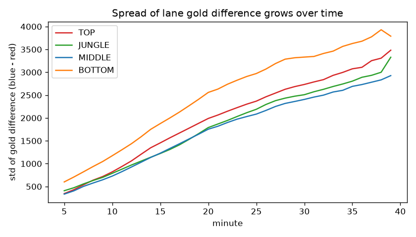

**[Fig. 1]** 분 시점별 라인 골드 격차의 표준편차

후보를 선택하는 기준은 해당 지표의 격차 부호가 경기 승패를 얼마나 잘 맞히는가로 설정했다.
타겟 변수는 개인의 과정 지표여야 하지만, 승패와 무관한 지표라면 경기력을 대변한다고 보기 어렵기 때문이다.
이는 선행 연구에서 제공한 `evaluate_y.py`(게임 종료 시점 팀 합계 골드의 우위로 승패를 맞히는 정확도)를 라인별 격차, 여러 시점, 여러 후보로 확장한 것이다(`evaluate_y_full.py`).
이때 게임 종료 시점의 값에는 "이겨서 벌어진 격차"가 섞여 정확도가 부풀려지므로, 종료 시점과 함께 10분, 15분, 20분의 고정 시점 정확도를 비교했다.
실험은 정제 후 전체 36,527게임으로 수행했다.

| 시점 | 라인 | 골드 | XP | 가한 피해 | 골드+XP | 골드+피해 |
|---|---|---|---|---|---|---|
| 종료 | TOP | 0.742 | 0.845 | 0.643 | 0.811 | 0.709 |
| 종료 | JUNGLE | 0.816 | 0.902 | 0.689 | 0.878 | 0.772 |
| 종료 | MIDDLE | 0.771 | 0.855 | 0.660 | 0.832 | 0.736 |
| 종료 | BOTTOM | 0.857 | 0.944 | 0.701 | 0.925 | 0.800 |
| 10분 | TOP | 0.560 | 0.553 | 0.539 | 0.559 | 0.555 |
| 10분 | JUNGLE | 0.584 | 0.577 | 0.554 | 0.588 | 0.574 |
| 10분 | MIDDLE | 0.568 | 0.549 | 0.545 | 0.567 | 0.564 |
| 10분 | BOTTOM | 0.582 | 0.567 | 0.555 | 0.578 | 0.574 |
| 15분 | TOP | 0.589 | 0.578 | 0.555 | 0.587 | 0.580 |
| 15분 | JUNGLE | 0.612 | 0.617 | 0.571 | 0.623 | 0.598 |
| 15분 | MIDDLE | 0.602 | 0.587 | 0.558 | 0.599 | 0.588 |
| 15분 | BOTTOM | 0.619 | 0.607 | 0.567 | 0.621 | 0.603 |
| 20분 | TOP | 0.623 | 0.628 | 0.579 | 0.630 | 0.612 |
| 20분 | JUNGLE | 0.676 | 0.703 | 0.599 | 0.700 | 0.649 |
| 20분 | MIDDLE | 0.639 | 0.639 | 0.586 | 0.647 | 0.625 |
| 20분 | BOTTOM | 0.683 | 0.690 | 0.603 | 0.699 | 0.652 |

**[Table 2]** 타겟 변수 후보별 승패 부호 일치율 (36,527게임)

후보 간 차이가 우연인지 확인하기 위해 부트스트랩(bootstrap)을 사용했다.
부트스트랩은 가진 데이터에서 게임을 무작위로 다시 뽑아(같은 게임이 여러 번 뽑힐 수 있다) 원래와 같은 크기의 가상 데이터를 만들고, 그때마다 정확도 차이를 다시 계산하는 과정을 1,000번 반복하는 방법이다.
이렇게 얻은 1,000개의 차이 중 가운데 95%가 놓이는 범위를 95% 신뢰구간이라 하며, 이 구간이 0을 포함하지 않으면 차이가 우연이 아니라고 판단한다.

| 라인 | XP − 골드 | 골드+XP − 골드 | 골드+피해 − 골드 |
|---|---|---|---|
| TOP | −1.14%p (−1.57 \~ −0.71) | −0.27%p (−0.57 \~ +0.04) | −0.93%p (−1.31 \~ −0.54) |
| JUNGLE | +0.55%p (+0.06 \~ +1.02) | +1.12%p (+0.79 \~ +1.47) | −1.32%p (−1.69 \~ −0.97) |
| MIDDLE | −1.55%p (−2.01 \~ −1.07) | −0.31%p (−0.66 \~ +0.04) | −1.43%p (−1.83 \~ −1.04) |
| BOTTOM | −1.26%p (−1.70 \~ −0.81) | +0.17%p (−0.16 \~ +0.51) | −1.67%p (−2.03 \~ −1.33) |

**[Table 3]** 15분 시점 골드 단독 대비 정확도 차이 (괄호는 95% 신뢰구간)

결과는 다음과 같다.
피해량은 단독으로 모든 라인과 시점에서 가장 낮았고, 골드에 더하면 15분에 모든 라인에서 골드 단독보다 유의하게 정확도가 떨어졌다. 따라서 피해량은 타겟이 아닌 피처로 사용한다.
XP는 종료 시점에서 가장 높았지만, 15분에는 JUNGLE을 제외한 세 라인에서 골드보다 유의하게 낮아 시점에 따라 성능이 불안정했다.
골드+XP는 종료 시점에서 모든 라인 2위였고, 20분에는 TOP·MIDDLE·BOTTOM에서 1위, JUNGLE에서 XP와 0.3%p 차이의 2위였다. 15분에는 골드보다 유의하게 낮은 라인이 없었고 JUNGLE에서는 유의하게 높았다.
즉 골드+XP는 어떤 시점에서도 크게 밀리지 않는 가장 안정적인 후보이므로 **골드+XP**를 타겟 변수로 선택했다.

[Table 2]의 정확도가 무엇을 뜻하는지 보기 위해, 골드+XP 격차(타겟)의 크기별로 블루팀의 승리 확률을 계산했다([Fig. 2]).
모든 라인에서 격차가 클수록 승리 확률이 꾸준히 올라가며, 그 기울기는 시간이 지날수록 가팔라진다.
예를 들어 JUNGLE에서 타겟이 +2 이상일 때 승리 확률은 15분 75%, 20분 87%이고, −2 이하일 때는 15분 28%, 20분 16%이다.
반면 격차가 0 근처(−1\~+1)인 관측치가 전체의 약 40%를 차지하고, 이 구간의 승리 확률은 55\~61%에 머문다.
고정 시점 정확도가 60%대에 그치는 이유는 이처럼 격차가 작아 승패가 사실상 정해지지 않은 게임이 많기 때문이다.
즉 낮은 정확도는 타겟이 나빠서가 아니라 한 라인의 격차만으로는 팀 전체의 승패를 다 설명할 수 없다는 솔로랭크의 특성을 반영한다.

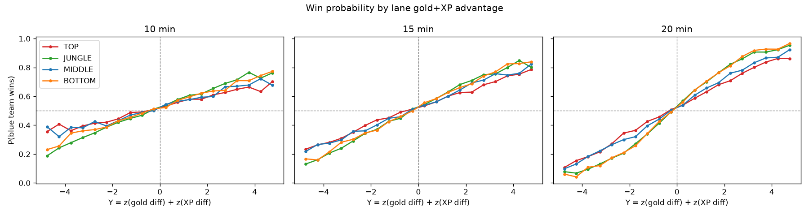

**[Fig. 2]** 골드+XP 격차에 따른 블루팀 승리 확률 (10, 15, 20분)

골드와 XP는 단위가 다르므로, 정보 손실을 막기 위해 분 시점별 z-score로 정규화한 뒤 동일 가중으로 더했다.
사전에 어느 쪽이 더 중요하다는 근거가 없으므로 동일 가중을 사용했다.
정규화에 쓰는 평균과 표준편차는 학습 데이터로만 계산해 평가 데이터의 정보가 학습에 섞이지 않도록 했다.

$$
y_{g,t} = \frac{\Delta Gold_{g,t} - \mu^{Gold}_t}{\sigma^{Gold}_t} + \frac{\Delta XP_{g,t} - \mu^{XP}_t}{\sigma^{XP}_t}
$$

여기서 $g$는 게임, $t$는 분 시점, $\Delta$는 블루팀 값 − 레드팀 값이다.
타겟에 사용한 골드와 XP, 그리고 XP로 결정되는 레벨은 자기 참조를 막기 위해 피처에서 제외했다.

### 2.2 라인별 피처 설정

피처는 선행 연구[[2]](https://www.kci.go.kr/kciportal/ci/sereArticleSearch/ciSereArtiView.kci?sereArticleSearchBean.artiId=ART003327764)의 13개 피처와 각 라인의 역할에 대한 도메인 지식을 바탕으로 후보를 구성했다.
선행 연구는 이 피처들을 미드라이너의 성장, 리스크, 교전 관여, 오브젝트 관여의 네 범주로 설명한다.

다만 선행 연구의 피처를 그대로 사용하지는 않았다. XP는 타겟에 포함되므로 제외했고, soloDeaths와 objPart는 각각 격차 계산 시의 완전 중복과 낮은 관련성 때문에 제외했다(아래 설명 참조).
또한 선행 연구의 CS는 미니언과 정글 몬스터를 합산했으나, 이 연구에서는 라인 특성을 반영하기 위해 둘을 분리했다.
여기에 로밍, 갱킹, 포탑 방패, 와드, ADC/SPT 역할 분리 등 선행 연구에 없는 피처를 라인별로 추가했다.

모든 피처는 해당 분 시점까지의 누적값을 맞상대 격차로 계산하고, 분 시점별 z-score로 정규화했다. 누적·격차·분 단위 정규화로 방식을 통일한 것은 선행 연구와의 비교 가능성을 유지하기 위해서다.
라인 공통으로 사용하는 피처와 라인별 역할을 반영하는 고유 피처는 다음과 같이 정의했다.

| 구분 | 피처 | 정의 | 반영하는 특성 |
|---|---|---|---|
| 공통 | minionsKilled | 미니언 처치 수 (TOP, MIDDLE, ADC의 CS) | 라인 성장 |
| 공통 | jungleMinionsKilled | 정글 몬스터 처치 수 (JUNGLE의 CS) | 정글 성장 |
| 공통 | kills, deaths, assists | 챔피언 처치·사망·처치 관여 횟수 | 교전 성과와 생존 |
| 공통 | dmgToChamp | 적 챔피언에게 가한 피해량 | 교전 기여 |
| 공통 | dmgTaken | 받은 피해량 | 교전 노출 |
| 고유 | soloKills | 어시스트 없이 같은 포지션의 맞상대를 처치한 횟수 | 라인전 1:1 기량 |
| 고유 | plates | 포탑 방패 파괴 횟수 | 사이드 라인 압박 |
| 고유 | killPart | (킬 + 어시스트) / 팀 전체 킬 | 교전 관여 |
| 고유 | objKA | 엘리트 몬스터(드래곤, 전령, 바론 등) 처치 또는 어시스트 횟수 | 오브젝트 관여 |
| 고유 | wardsPlaced, wardsKilled | 와드 설치·제거 횟수 | 시야 |
| 고유 | ccEnemy_ms | 적에게 건 군중제어 시간(ms) | 아군 지원 |
| 고유 | roamKA_e14 | 자기 라인 구역 밖에서 발생한 킬에 관여한 횟수(14분까지, 아래 "로밍과 갱킹의 정의" 참조) | 로밍 |
| 고유 | gankKA_e14 | 라인 구역(탑·미드·봇)에서 발생한 킬에 관여한 횟수(14분까지, 아래 "로밍과 갱킹의 정의" 참조) | 정글 갱킹 |

**[Table 4]** 라인 공통 피처와 고유 피처의 정의

#### 라인별 피처 선정 근거

라인별 피처는 세 가지 근거로 선정했다.
첫째, 선행 연구[2]에서 미드라이너의 기여 요인으로 사용한 피처를 출발점으로 삼았다.
둘째, 각 라인의 역할에 대한 도메인 지식으로 라인 고유 피처를 추가했다.
셋째, 모든 후보 피처가 실제로 타겟과 관련이 있는지 전체 데이터로 확인했다([Fig. 3]).

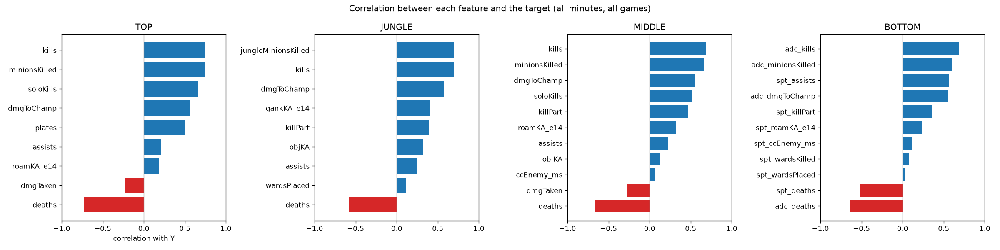

**[Fig. 3]** 라인별 피처와 타겟의 상관 (36,527게임, 5\~40분)

| 라인 | 피처 | 선정 근거 | 타겟과의 상관 |
|---|---|---|---|
| 공통 | CS, 킬, 데스, 어시스트, 가한 피해 | 선행 연구[2]의 성장·교전·리스크 피처 | CS 0.60\~0.74, 킬 0.68\~0.75, 데스 −0.51\~−0.73 |
| TOP | 솔로킬 | 정글 개입이 상대적으로 적어 1:1 라인전이 긴 라인(도메인), 선행 연구[2]의 솔로킬 | 0.65 |
| TOP | 포탑 방패 | 사이드 라인 압박을 직접 보여 주는 지표(도메인) | 0.51 |
| TOP | 받은 피해 | 선행 연구[2]의 리스크 피처, 탱커·브루저가 많은 라인 | −0.23 |
| JUNGLE | 정글 CS | 정글러의 성장 원천은 미니언이 아닌 정글 몬스터(도메인) | 0.70 |
| JUNGLE | 오브젝트 관여 | 드래곤·전령·바론 처치를 주도하는 역할(도메인), 선행 연구[2]의 objKA | 0.32 |
| JUNGLE | 갱킹, 킬 관여율 | 라인에 개입해 아군의 우위를 만드는 역할(도메인) | 0.40, 0.40 |
| JUNGLE | 와드 설치 | 적 정글 동선 파악을 위한 시야(도메인) | 0.11 |
| MIDDLE | 솔로킬, 킬 관여율 | 선행 연구[2]가 미드의 라인전 기량과 라인 이탈 후 교전 관여로 설명한 피처 | 0.52, 0.47 |
| MIDDLE | 로밍 | 맵 중앙에 있어 양쪽 라인 지원이 쉬운 역할(도메인), 이 연구에서 추가 | 0.32 |
| MIDDLE | CC 시간 | 선행 연구[2]의 전투 스타일 피처 | 0.06 |
| BOTTOM | ADC: CS, 킬, 데스, 가한 피해 | 성장해 피해를 넣는 원거리 딜러의 역할(도메인) | 0.55\~0.69 (데스 −0.64) |
| BOTTOM | SPT: 어시스트, 킬 관여율, 데스 | 직접 킬보다 관여와 생존으로 기여하는 서포터의 역할(도메인) | 0.57, 0.36, −0.51 |
| BOTTOM | SPT: 와드 설치·제거, CC, 로밍 | 시야 장악, 아군 보호, 다른 라인 지원(도메인) | 0.03, 0.08, 0.11, 0.23 |

**[Table 5]** 라인별 피처 선정 근거

#### 로밍과 갱킹의 정의

로밍은 라이너가 자기 라인을 떠나 다른 라인이나 정글의 교전에 합류하는 플레이이고, 갱킹은 정글러가 라인에 개입해 적 라이너를 처치하려는 플레이이다.
둘 다 LoL에서 중요한 기여 방식이지만 공식 데이터에는 해당 지표가 없으므로 직접 정의해야 한다.

타임라인 데이터는 플레이어 위치를 1분에 한 번만 기록하므로, 위치 스냅샷으로는 짧은 로밍을 대부분 놓친다.
반면 챔피언 처치 이벤트에는 발생 시각과 정확한 좌표가 기록된다.
따라서 이 연구는 로밍을 "자기 라인 구역 밖에서 발생한 킬에 처치자 또는 어시스트로 관여한 횟수", 갱킹을 "라인 구역(탑·미드·봇)에서 발생한 킬에 정글러가 관여한 횟수"로 정의했다.
이 정의는 킬로 이어진 로밍만 포착하며, 킬 없이 끝난 로밍 시도는 반영하지 못한다는 한계가 있다.

킬 좌표는 맵을 TOP, MID, BOT, JUNGLE(강가 포함), BASE 다섯 구역으로 나누어 분류했다([Fig. 4]).
구역 경계는 연구자가 정한 근사 기준이므로 전체 데이터로 검증했다.
10분 이전에 같은 라인의 맞상대끼리 발생한 킬은 대부분 해당 라인에서 일어나므로, 이 킬이 해당 라인 구역으로 분류되는 비율을 계산했다(BOTTOM은 2대2 라인이므로 ADC·SPT 간 교차 킬 포함).
그 결과 241,523건 중 84.9%가 올바르게 분류되었으며, 라인별로는 TOP 91.3%, BOTTOM 85.6%, MIDDLE 75.3%였다.
MIDDLE이 낮은 것은 미드 라인 구역을 맵 중앙의 좁은 대각선 띠로 정의해, 미드 라인과 붙어 있는 강가에서 일어난 교전이 정글 구역으로 분류되기 때문이며 이는 구역 정의의 한계이다.

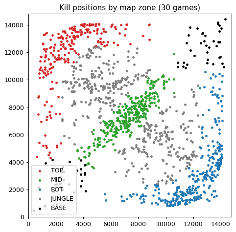

**[Fig. 4]** 맵 구역 분류 (전체 데이터의 챔피언 처치 위치 중 무작위 1만 건)

로밍과 갱킹은 라인전 단계의 개념이다. 게임 중후반에는 다섯 명이 모여 교전하므로, 그때 라인 밖에서 발생한 킬 관여는 로밍이 아니라 한타에 가깝다.
따라서 라인전이 끝나는 시점까지의 값만 사용해야 하며, 이 연구는 그 기준을 14분으로 정했다. 근거는 두 가지이다.

첫째, 게임 규칙이다. 분석 기간(2025년 1\~4월, 패치 15.1\~15.7)에는 14분에 포탑 방패가 사라졌으며, 실제로 데이터에서도 15분 이후의 포탑 방패 파괴 이벤트는 한 건도 없었다. 포탑 방패는 파괴할 때마다 골드를 주므로 그 전까지는 라이너가 자기 라인에 머물 동기가 크고, 방패가 사라지면 라인을 떠나 합류할 동기가 커진다. 이후 패치에서 포탑 방패 규칙이 바뀐다면 이 기준도 다시 검토해야 한다.

둘째, 데이터이다. 매 분 새로 발생한 킬 관여 중 자기 라인 밖에서 발생한 비율을 계산하면([Fig. 5]), 14분까지 TOP과 ADC는 10\~60% 수준이지만 14분 이후 빠르게 상승해 17분에는 TOP 79%, ADC 92%, SPT 90%에 이른다.
즉 14분을 기점으로 라인전 단계가 끝나고 합류·한타 단계로 넘어간다.
정글러의 라인 구역 관여 비율도 14분 61%에서 17분 53%, 26분 이후 39%로 꾸준히 낮아져, 갱킹이 라인전 단계의 플레이라는 점을 보여 준다.
MIDDLE은 앞서 설명한 구역 정의의 한계 때문에 7분 이후 줄곧 약 70%로 높게 나타난다.

이에 따라 로밍과 갱킹은 14분까지의 누적값을 사용하고, 14분 이후 시점에는 14분의 값을 그대로 유지했다.

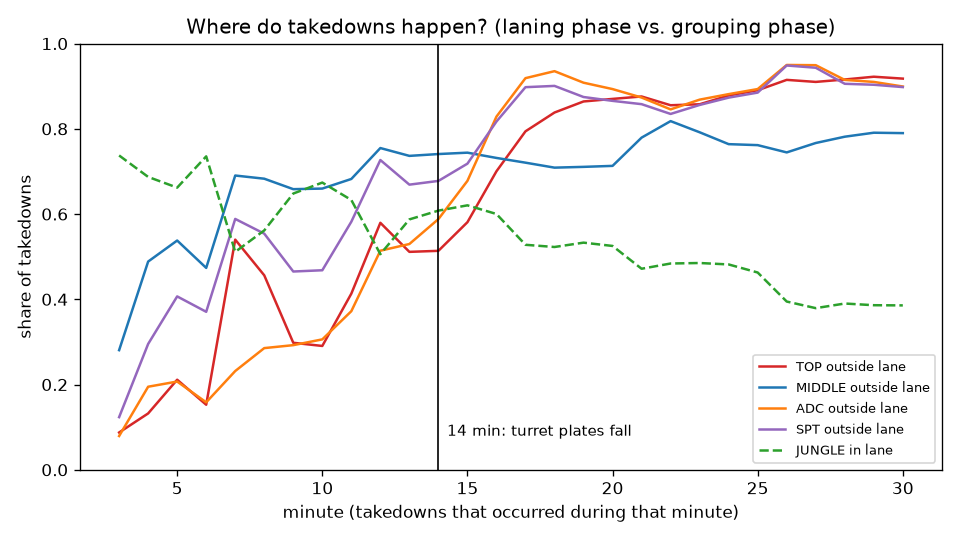

**[Fig. 5]** 분 시점별 라인 밖 킬 관여 비율(라이너)과 라인 구역 킬 관여 비율(정글)

#### 제외한 피처와 최종 피처

솔로데스(soloDeaths)는 제외했다. 격차로 계산하면 "블루가 맞상대를 솔로킬한 수"와 "레드가 맞상대에게 솔로데스한 수"가 같아져, 전체 데이터에서 모든 라인의 솔로킬 격차와 솔로데스 격차의 상관이 정확히 −1이었기 때문이다.
선행 연구의 objPart(오브젝트 관여 비율)도 제외했다. 타겟과의 상관이 −0.02\~0.08로 거의 없어 objKA(0.13\~0.32)보다 모든 라인에서 약했고, TOP과 MIDDLE에서는 objKA와 상관이 각각 0.78, 0.74로 정보가 겹쳤다.
최종 라인별 피처는 다음과 같다.

| 라인 | 피처 (개수) |
|---|---|
| TOP (9) | CS, 킬, 데스, 어시스트, 솔로킬, 포탑 방패, 가한 피해, 받은 피해, 로밍 |
| JUNGLE (9) | 정글 CS, 킬, 데스, 어시스트, 킬 관여율, 오브젝트 관여, 가한 피해, 와드 설치, 갱킹 |
| MIDDLE (11) | CS, 킬, 데스, 어시스트, 솔로킬, 킬 관여율, 오브젝트 관여, 가한 피해, 받은 피해, CC 시간, 로밍 |
| BOTTOM (11) | ADC: CS, 킬, 데스, 가한 피해 / SPT: 어시스트, 데스, 킬 관여율, 와드 설치, 와드 제거, CC 시간, 로밍 |

**[Table 6]** 라인별 최종 피처

각 라인의 피처는 다음과 같은 이유로 구성했다. 괄호 안의 숫자는 전체 데이터에서 계산한 타겟과의 상관이다([Fig. 3]).

**TOP.** 탑은 맵 왼쪽 끝의 사이드 라인으로, 정글러의 개입이 상대적으로 적어 1:1 라인전이 길게 이어진다. 따라서 라인전에서 얼마나 성장하고 버티는지가 핵심이다. 성장은 CS(0.74)로, 교전 성과는 킬(0.75)과 데스(−0.73)로 나타냈으며, 맞상대를 혼자 처치한 솔로킬(0.65)로 1:1 기량을 별도로 반영했다. 포탑 방패(0.51)는 라인 우위를 상대 포탑 압박으로 바꾸는 사이드 라인 운영을 나타낸다. 탑에는 탱커와 브루저가 많아 교전에서 피해를 주고받는 양이 크므로 가한 피해(0.56)와 받은 피해(−0.23)를 함께 넣었다. 어시스트(0.21)와 로밍(0.18)은 탑이 라인을 벗어나 팀 교전에 관여한 정도를 나타내며, 사이드 라인 특성상 다른 라인보다 상관이 낮다.

**JUNGLE.** 정글러는 라인 없이 정글 몬스터로 성장하며, 라인에 개입하고 오브젝트를 주도하는 역할이다. 성장은 미니언 대신 정글 CS(0.70)로 나타냈다. 라인 개입은 라인 구역에서 발생한 킬에 관여한 갱킹(0.40)과 팀 전체 킬 중 자신이 관여한 비율인 킬 관여율(0.40)로 반영했고, 교전 성과는 킬(0.69), 데스(−0.59), 어시스트(0.24), 가한 피해(0.58)로 나타냈다. 드래곤·전령·바론 같은 엘리트 몬스터 처치에 관여한 오브젝트 관여(0.32)는 정글러의 고유 역할을 반영하며, 와드 설치(0.11)는 적 정글러의 동선을 파악하기 위한 시야 활동을 나타낸다.

**MIDDLE.** 미드는 맵 중앙에 있어 라인전과 함께 양쪽 라인으로의 지원이 모두 중요한 라인이다. 선행 연구[2]의 미드라이너 피처를 출발점으로, 성장은 CS(0.66), 교전 성과는 킬(0.68), 데스(−0.66), 어시스트(0.22), 가한 피해(0.55), 받은 피해(−0.28)로 나타냈다. 라인전 기량은 솔로킬(0.52)로, 라인을 벗어난 교전 관여는 킬 관여율(0.47)과 로밍(0.32)으로 반영했다. 오브젝트 관여(0.13)는 정글러와 함께 오브젝트 싸움에 합류하는 정도를, CC 시간(0.06)은 선행 연구에서 전투 스타일을 나타내는 피처로 사용한 군중제어 기여를 나타낸다.

**BOTTOM.** 바텀은 원거리 딜러(ADC)와 서포터(SPT) 두 명이 함께 서는 라인으로, 두 역할의 기여 방식이 뚜렷하게 다르므로 피처를 역할별로 나누었다. ADC는 성장해서 지속적으로 피해를 넣는 역할이므로 CS(0.60), 킬(0.69), 가한 피해(0.55)와 생존을 나타내는 데스(−0.64)로 구성했다. SPT는 CS를 거의 획득하지 않고 아군을 지원하는 역할이므로 직접적인 킬 대신 어시스트(0.57)와 킬 관여율(0.36)로 교전 관여를 나타냈고, 데스(−0.51)로 생존을 반영했다. 또한 시야 장악은 와드 설치(0.03)와 와드 제거(0.08)로, 아군 보호와 교전 개시는 CC 시간(0.11)으로, 다른 라인 지원은 로밍(0.23)으로 나타냈다. 서포터의 시야 피처는 타겟과의 상관이 매우 낮은데, 이는 골드+XP 타겟이 시야 장악과 같은 서포터의 기여를 담지 못하기 때문이다.

BOTTOM은 ADC와 SPT의 피처를 분리해 넣어, 하나의 듀오 모델 안에서 두 역할의 기여를 구분할 수 있도록 했다.
모든 라인에서 피처의 분산팽창계수(VIF)는 최대 4.18로 5 미만이며, 피처 간 중복으로 가중치가 왜곡될 위험은 크지 않다.
VIF는 한 피처가 나머지 피처들로 얼마나 잘 설명되는지를 나타내며, 값이 클수록 다른 피처와 정보가 겹친다는 뜻이다. 일반적으로 5 이상이면 주의, 10 이상이면 심각한 중복으로 본다.

서포터 고유 피처인 와드 설치(0.03), 와드 제거(0.08), CC 시간(0.11)은 타겟과의 상관이 매우 낮았다.
이는 데이터 오류가 아니라 골드+XP라는 타겟이 시야 장악과 같은 서포터의 기여를 담지 못한다는 것을 의미한다.
그럼에도 서포터의 역할 특성을 모델에 반영하고 그 영향이 작다는 사실 자체를 확인하기 위해 피처에 포함했다.

---

## 3. 경기력 지표 모델링

---

### 3.1 모델 선정

입력은 분 시점 $t$까지의 라인별 피처 격차이고, 출력은 같은 시점의 골드+XP 격차이다.
피처는 골드와 XP를 직접 포함하지 않지만 골드와 XP를 얻는 과정(CS, 킬, 생존 등)을 담고 있으므로, 피처로 타겟을 설명하는 회귀 문제로 모델링할 수 있다.
학습된 모델의 예측값 $\hat{y}$가 곧 해당 시점의 TCI이며, "골드와 XP를 보지 않고 플레이 과정만으로 추정한 맞상대 대비 우위"로 해석한다.

같은 게임의 여러 분 시점은 서로 강하게 연관되므로, 데이터는 **게임 단위**로 분할했다.
36,527게임을 학습 80%(29,222게임, 680,075행)와 평가 20%(7,305게임, 169,709행)로 나누었고, 두 집합에 겹치는 게임은 없다.
하이퍼파라미터(모델의 설정값)는 학습 데이터에서 교차검증으로 선택했다.
교차검증은 학습 데이터를 게임 단위로 5개 묶음(fold)으로 나눈 뒤, 4개로 학습하고 나머지 1개로 성능을 확인하는 과정을 묶음을 바꿔 가며 반복하는 방법이다. 평가 데이터를 건드리지 않고도 설정값을 공정하게 고를 수 있으며, 평가 데이터는 최종 성능 측정에만 한 번 사용했다.

모델은 성격이 다른 두 계열에서 대표를 하나씩 골라 비교했다. 선형 계열에서는 릿지 회귀(Ridge)를, 트리·부스팅 계열에서는 XGBoost를 선택했다.
Ridge는 피처와 타겟의 관계를 가중합(직선)으로 가정하는 대신 가중치를 그대로 해석할 수 있고, XGBoost는 비선형 관계와 피처 간 상호작용까지 학습할 수 있는 대신 해석이 어렵다.
두 모델의 성능 차이를 보면 "선형으로 충분한가, 비선형 모델이 필요한가"를 판단할 수 있다.
예비 실험에서 일반 선형회귀, 라쏘 회귀, 결정 나무, 랜덤 포레스트, LightGBM도 같은 조건으로 학습했으며, 각 계열 안에서 Ridge와 XGBoost가 가장 높거나 같은 성능을 보였다.

**기준선 (Baseline_CS).** CS 격차 하나만 사용하는 선형회귀이다. CS는 골드와 XP의 가장 큰 원천이므로, 이 기준선은 "골드 공식을 재현하는 수준"을 나타낸다. 두 모델이 기준선보다 높인 설명력이 CS 이외의 과정 정보에서 나온 몫이다.

**릿지 회귀 (Ridge).** 선형회귀는 각 피처에 가중치를 곱해 더한 값으로 타겟을 예측하며, 예측값과 실제값의 차이를 제곱해 더한 값이 가장 작아지는 가중치 $w$를 찾는다. 릿지 회귀는 여기에 "가중치가 너무 커지지 않게 하는 벌점"을 더한 것이다.

$$
\min_w \sum_i (y_i - w^\top x_i)^2 + \alpha \sum_j w_j^2
$$

앞의 항은 예측 오차, 뒤의 항은 가중치 크기의 제곱합이다. 벌점이 필요한 이유는, 킬과 가한 피해처럼 비슷한 정보를 가진 피처가 함께 있으면 한쪽 가중치가 지나치게 커지고 다른 쪽이 반대로 작아지는 식으로 가중치가 불안정해지기 때문이다. 벌점은 이런 극단적인 가중치를 억제해 결과를 안정시키며, 이처럼 모델에 제약을 걸어 과적합을 막는 것을 정규화(regularization)라 한다. $\alpha$는 벌점의 세기로, 클수록 가중치가 0 쪽으로 강하게 줄어든다.

$\alpha$는 $10^{-3}$부터 $10^{3}$까지 13개 값 중 교차검증 오차가 가장 작은 값을 선택했으며, TOP·JUNGLE·MIDDLE은 31.6, BOTTOM은 316이 선택되었다. 학습 데이터가 68만 행으로 매우 많아 이 정도의 벌점은 가중치를 거의 바꾸지 않으며, 실제로 일반 선형회귀와 성능이 같았다. 피처가 가장 많고 서로 겹치는 정보가 상대적으로 많은 BOTTOM에서 더 강한 벌점이 선택되었다.

**XGBoost.** XGBoost는 결정 나무 여러 개를 이어 붙인 모델이다. 결정 나무는 "킬 격차가 2 이상인가?", "그렇다면 CS 격차가 10 이상인가?"처럼 질문을 차례로 던져 데이터를 나누고, 마지막에 도착한 칸에 속한 데이터의 평균을 예측값으로 내놓는 모델이다. 나무 하나는 단순해서 정확도가 낮지만, 여러 개를 합치면 복잡한 관계도 표현할 수 있다.

나무를 합치는 방법이 부스팅(boosting)이다. 첫 번째 나무가 예측하고 남은 오차(실제값 − 예측값)를 두 번째 나무가 다시 예측하고, 그래도 남은 오차를 세 번째 나무가 예측하는 식으로, 나무를 하나씩 추가하면서 앞선 나무들이 틀린 부분을 조금씩 고쳐 나간다. 시험을 본 뒤 틀린 문제만 골라 다시 공부하는 과정을 반복하는 것과 비슷하다. $m$번째 나무까지 사용한 예측은 다음과 같다.

$$
\hat{y}^{(m)} = \hat{y}^{(m-1)} + \eta f_m(x)
$$

여기서 $\hat{y}^{(m-1)}$은 앞선 나무들의 예측, $f_m$은 새로 추가한 나무, $\eta$는 학습률이다. 학습률은 새 나무의 예측을 얼마나 반영할지 정하는 값으로, 작게 두면 한 번에 조금씩만 고쳐 안정적으로 학습한다. 각 나무가 맞히려는 "남은 오차"는 정확히는 오차를 줄이려면 예측을 어느 방향으로 얼마나 바꿔야 하는지를 나타내는 값(기울기, gradient)이며, 그래서 이 방법을 그래디언트 부스팅이라 부른다.

XGBoost(eXtreme Gradient Boosting)는 그래디언트 부스팅을 빠르고 과적합에 강하게 개선한 방법이다. 과적합은 모델이 학습 데이터의 우연한 특징까지 외워 버려, 처음 보는 데이터에서는 오히려 성능이 떨어지는 현상이다. XGBoost는 나무가 지나치게 복잡해지지 않도록 나무의 크기와 예측값의 크기에 벌점을 주어 과적합을 억제한다.

설정은 다음과 같다. 학습률은 0.05, 나무의 최대 깊이(질문을 이어서 던지는 최대 횟수)는 6으로 두었고, 나무마다 학습 데이터의 행과 피처를 80%씩 무작위로 뽑아 사용해 나무들이 서로 다른 부분을 보도록 했다. 나무 개수는 조기 종료로 결정했다. 조기 종료는 나무를 하나씩 추가할 때마다 검증 데이터의 오차를 확인해, 50개를 더 추가해도 오차가 줄지 않으면 학습을 멈추는 방법으로, 나무가 너무 많아져 과적합되는 것을 막는다. 그 결과 나무 개수는 TOP 646개, JUNGLE 627개, MIDDLE 568개, BOTTOM 998개였다.

평가 지표는 다음 네 가지를 사용했다.
MSE(평균 제곱 오차)는 예측값과 실제값 차이를 제곱해 평균한 값으로, 큰 오차에 더 큰 벌점을 준다.
RMSE는 MSE의 제곱근으로, 타겟과 같은 단위로 "평균적으로 얼마나 틀리는가"를 나타낸다. 타겟은 표준편차가 약 1.85인 z-score 합이므로, RMSE 0.66은 타겟 표준편차의 약 1/3만큼 틀린다는 뜻이다.
MAE(평균 절대 오차)는 차이의 절댓값 평균으로, 큰 오차에 덜 민감하다.
R²(결정계수)는 타겟의 변동 중 모델이 설명한 비율로, 1에 가까울수록 좋고 0이면 평균으로만 예측한 것과 같다.
여기에 선행 연구와 비교하기 위해, 예측 TCI의 부호가 실제 골드 격차의 부호와 일치하는 비율(부호 일치율)을 함께 계산했다. 즉 "TCI가 앞선다고 한 쪽이 실제로 골드도 앞서는가"의 비율이다. 선행 연구와 동일하게 골드 격차의 절댓값이 100 미만인 사실상 동점 구간은 제외했다.

### 3.2 모델링 결과

평가 데이터(7,305게임)에서의 성능은 다음과 같다.

| 라인 | Baseline_CS R² | Ridge R² | XGBoost R² | Ridge RMSE (MSE) | XGBoost RMSE (MSE) |
|---|---|---|---|---|---|
| TOP | 0.545 | 0.879 | 0.882 | 0.660 (0.435) | 0.650 (0.422) |
| JUNGLE | 0.484 | 0.875 | 0.879 | 0.652 (0.425) | 0.643 (0.413) |
| MIDDLE | 0.436 | 0.848 | 0.851 | 0.720 (0.519) | 0.714 (0.509) |
| BOTTOM | 0.369 | 0.735 | 0.745 | 0.955 (0.911) | 0.935 (0.875) |

**[Table 7]** 대표 모델의 평가 성능

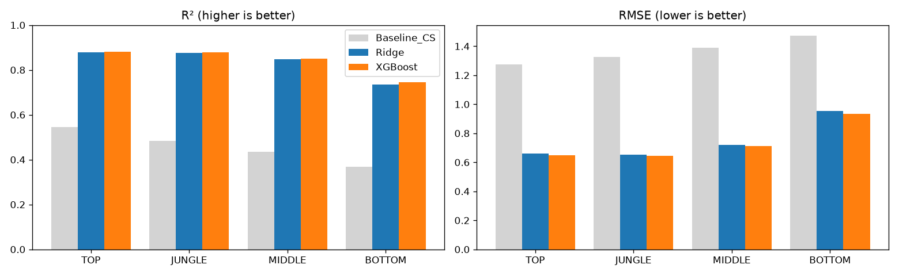

**[Fig. 6]** 라인별 R²와 RMSE 비교

두 모델 모두 CS만 쓴 기준선보다 R²가 0.30\~0.41 높았다. 피처가 골드 공식 이상의 과정 정보를 담고 있다는 의미이다.
다만 피처 중 CS, 킬, 어시스트는 골드와 XP를 직접 주는 원천이므로, TCI는 실제 골드+XP 격차와 높은 상관을 갖는다. 따라서 TCI의 의의는 골드+XP 격차를 새로 예측하는 데보다, 그 우위가 어떤 플레이에서 비롯되었는지를 가중치로 분해하고 라인별 차이를 드러내는 데 있다.

XGBoost는 모든 라인에서 Ridge보다 조금 더 정확했다. 2.1절과 같은 부트스트랩(평가 게임 500회 재추출)으로 확인한 R² 차이의 95% 신뢰구간은 TOP 0.003\~0.005, JUNGLE 0.003\~0.004, MIDDLE 0.002\~0.004, BOTTOM 0.009\~0.012로 모두 0보다 커서 우연은 아니다. 그러나 그 크기는 1%p 이하이다.

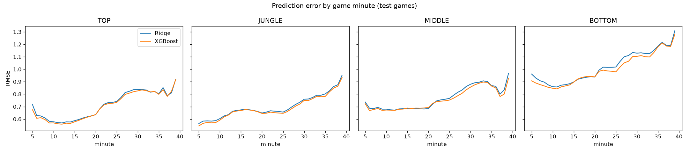

**[Fig. 7]** 분 시점별 예측 오차(RMSE)

시간대별로 보면 두 모델의 오차 곡선은 거의 겹친다([Fig. 7]). 두 모델 모두 게임 후반으로 갈수록 오차가 커지는데, 한타와 오브젝트 교전처럼 라인 피처로 설명하기 어려운 요인이 늘어나기 때문이다.
XGBoost의 이점은 주로 모든 라인의 게임 초반(5\~10분), BOTTOM의 20분 이후, MIDDLE의 25분 이후에 나타나며, 그 외 구간에서는 차이가 거의 없다.

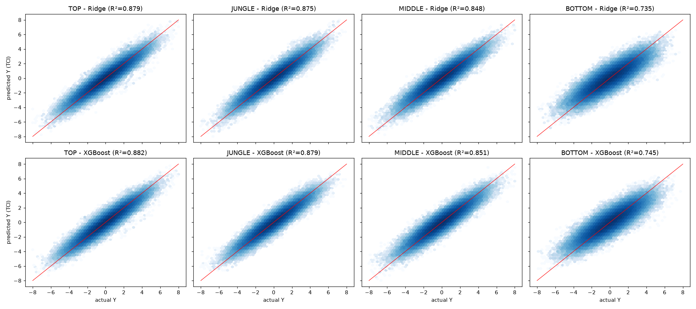

**[Fig. 8]** 예측값과 실제값 (색이 진할수록 관측치가 많음, 빨간 선은 완벽한 예측)

예측값과 실제값의 분포도 두 모델이 거의 같다([Fig. 8]). 점들이 빨간 대각선 주위에 모여 있어 큰 편향 없이 예측하며, BOTTOM은 다른 라인보다 퍼짐이 넓어 설명력이 낮다. 서포터 피처가 골드+XP와 관련이 약하기 때문이다.

결론적으로 XGBoost가 통계적으로는 더 정확하지만 그 이득은 1%p 이하이고, 시간대와 분포 어디에서도 뚜렷한 차이가 없다. 즉 피처와 타겟의 관계는 대부분 선형으로 설명된다.
따라서 해석 가능성을 우선해 **Ridge를 최종 TCI 모델로 선정**했다.
Ridge는 가중치가 곧 각 피처의 기여도이므로 TCI를 식으로 제시할 수 있고, 선형식이라 BOTTOM의 TCI를 ADC 항과 SPT 항으로 나눌 수 있다(4.1절).

| 라인 | Baseline_CS | Ridge | XGBoost |
|---|---|---|---|
| TOP | 78.7% | 92.7% | 92.6% |
| JUNGLE | 67.5% | 88.0% | 87.9% |
| MIDDLE | 71.6% | 90.0% | 89.8% |
| BOTTOM | 71.8% | 86.7% | 86.7% |

**[Table 8]** 예측 TCI와 골드 격차의 부호 일치율 (|골드 격차| ≥ 100)

| 분 구간 | 5\~9 | 10\~14 | 15\~19 | 20\~24 | 25\~29 | 30\~34 | 35\~39 |
|---|---|---|---|---|---|---|---|
| TOP | 97.5% | 95.0% | 92.1% | 90.2% | 88.6% | 87.1% | 86.1% |
| JUNGLE | 90.0% | 87.7% | 87.5% | 87.6% | 87.6% | 86.2% | 86.0% |
| MIDDLE | 94.7% | 91.3% | 89.2% | 88.0% | 87.0% | 85.7% | 86.4% |
| BOTTOM | 89.9% | 88.3% | 86.2% | 85.3% | 83.6% | 82.1% | 80.6% |

**[Table 9]** 시간대별 Ridge TCI와 골드 격차의 부호 일치율

선행 연구와 같이 게임 후반으로 갈수록 부호 일치율이 감소하는 경향이 모든 라인에서 나타났다.
참고로 선행 연구의 미드라이너 TCI는 같은 조건에서 부호 일치율 80.78%였고, 이 연구의 MIDDLE TCI는 90.0%였다.
다만 선행 연구는 골드를 전혀 보지 않는 비지도학습이고 이 연구는 골드+XP를 타겟으로 학습했으므로, 두 수치를 직접적인 우열로 해석해서는 안 된다.

최종 TCI의 가중치(Ridge 계수)는 다음과 같다. 오차 막대는 학습 게임을 단위로 100회 부트스트랩한 95% 신뢰구간이며, 모든 계수의 신뢰구간 폭은 0.027 이하로 안정적이다.

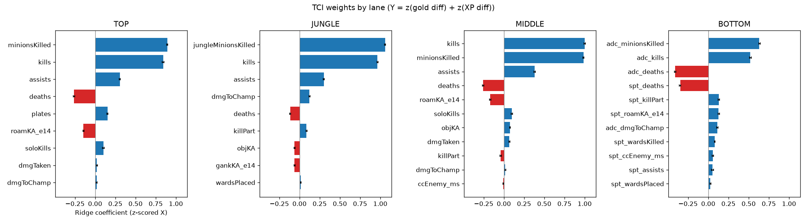

**[Fig. 9]** 라인별 TCI 가중치

그림의 피처 이름은 [Table 4]의 피처 정의와 대응하며, Roaming과 Ganking은 14분까지의 값을 고정한 roamKA_e14, gankKA_e14를 의미한다. [ADC], [SPT]는 BOTTOM 모델 안에서 해당 피처가 속한 역할을 나타낸다.
주요 항만 표기한 라인별 TCI는 다음과 같다(절편은 0).

$$
\begin{aligned}
TCI_{TOP} &= 0.89\,z_{CS} + 0.84\,z_{kills} + 0.31\,z_{assists} - 0.26\,z_{deaths} + 0.15\,z_{plates} - 0.15\,z_{roam} + 0.10\,z_{soloKills} + \cdots \\
TCI_{JUNGLE} &= 1.06\,z_{jungleCS} + 0.97\,z_{kills} + 0.30\,z_{assists} + 0.12\,z_{dmgToChamp} - 0.12\,z_{deaths} + 0.09\,z_{killPart} + \cdots \\
TCI_{MIDDLE} &= 1.00\,z_{kills} + 0.99\,z_{CS} + 0.38\,z_{assists} - 0.26\,z_{deaths} - 0.17\,z_{roam} + 0.10\,z_{soloKills} + \cdots \\
TCI_{BOTTOM} &= 0.63\,z_{CS}^{ADC} + 0.52\,z_{kills}^{ADC} - 0.41\,z_{deaths}^{ADC} - 0.35\,z_{deaths}^{SPT} + 0.13\,z_{killPart}^{SPT} + 0.13\,z_{roam}^{SPT} + \cdots
\end{aligned}
$$

모든 라인에서 CS와 킬이 가장 큰 두 축이고, 어시스트가 그다음이며, 데스는 감점 요인이다. 이들은 골드와 XP를 직접 주는 원천이므로 예상된 결과이다.
선행 연구의 PCA에서는 데스, 받은 피해 같은 리스크 지표의 로딩이 컸는데, 이 연구는 타겟을 정하고 학습했기 때문에 성장과 전투 지표의 가중치가 크게 나타났다.

라인 간 차이는 다음과 같다.
JUNGLE은 정글 CS의 가중치(1.06)가 모든 라인의 CS 가중치 중 가장 크고, 데스 감점(−0.12)은 라이너(−0.26)의 절반 이하이다. 정글러는 죽더라도 라인의 CS와 XP를 직접 놓치지 않기 때문으로 해석할 수 있다.
MIDDLE은 유일하게 킬의 가중치(1.00)가 CS(0.99)보다 크다.
TOP은 포탑 방패(0.15)가 고유 피처로 의미 있게 나타나 사이드 라인 압박을 반영한다.
BOTTOM은 서포터의 데스(−0.35)가 ADC의 데스(−0.41)와 비슷한 크기의 감점이며, 서포터의 생존이 듀오의 성장에 중요하다는 것을 보여준다.
로밍은 TOP(−0.15)과 MIDDLE(−0.17)에서 음수, SPT(+0.13)에서 양수로 라인에 따라 방향이 반대이다. 킬과 어시스트가 이미 모델에 포함되어 있으므로, 같은 킬 관여라도 라인 밖에서 했다면 라이너는 그동안 CS와 XP를 놓치지만, CS를 획득하지 않는 서포터는 그런 손실이 없다는 해석이 가능하다. 같은 피처가 라인에 따라 반대로 작용한다는 점은 라인별로 TCI를 설계해야 하는 근거가 된다.

계수를 해석할 때는 주의가 필요하다. 계수는 "다른 피처가 같을 때"의 관계이므로, 단독 상관과 부호가 반대로 나타날 수 있다.
실제로 로밍(TOP, MIDDLE), 받은 피해(TOP, MIDDLE), 오브젝트 관여·갱킹(JUNGLE), 킬 관여율·CC 시간(MIDDLE)은 타겟과의 단독 상관과 계수의 부호가 반대였다.
예를 들어 MIDDLE의 로밍은 단독으로는 타겟과 양의 상관(0.32)이지만 킬·어시스트를 고정하면 음의 계수(−0.17)가 된다. 이는 "로밍이 손해"라는 뜻이 아니라 "킬 관여가 같다면 라인에 머문 쪽이 성장에 유리하다"로 읽어야 한다.
또한 가한 피해량은 타겟과의 단독 상관(0.55\~0.58)이 높지만 계수는 0.02\~0.12로 작은데, 피해량의 정보 대부분이 킬에 이미 반영되어 있기 때문이다.
계수의 크기가 0.1 미만인 피처는 해석을 최소화했으며, 모든 계수는 연관성을 나타낼 뿐 인과관계를 의미하지 않는다.

---

## 4. TCI 모델의 활용

선행 연구는 분 단위 TCI를 게임 단위로 평균한 매치 기여 인덱스(Match Contribution Index, MCI)를 정의하고, 소환사별 MCI의 평균과 표준편차로 장기적인 기여 패턴을 분석했다.
이 연구는 같은 방식을 4개 라인, 5개 역할로 확장한다.

### 4.1 매치 기여 지수(MCI)의 정의

학습이 끝난 TCI는 고정된 식이므로, 활용 단계에서는 학습·평가 구분 없이 전체 36,527게임에 적용했다. 모델의 성능 검증은 3.2절에서 평가 데이터로만 수행했다.
각 게임에서 분 단위 TCI의 평균을 구하고, 블루팀 플레이어에게는 그대로, 레드팀 플레이어에게는 부호를 반전하여 부여했다.
이 값을 역할별 표준편차로 나눈 것을 MCI로 정의한다.

선행 연구의 MCI는 평균이 1이 되도록 변환했지만, 이 연구의 TCI는 맞상대와의 격차이므로 평균이 자연스럽게 0이 된다.
따라서 **MCI = 0은 맞상대와 대등, MCI = +1은 맞상대보다 1 표준편차만큼 우세**를 의미한다.

BOTTOM의 TCI는 선형식이므로 ADC 피처 항의 합과 SPT 피처 항의 합으로 나눌 수 있다.
ADC에게는 ADC 항의 합을, SPT에게는 SPT 항의 합을 각자의 점수로 부여하여, 듀오로 학습한 모델에서 개인별 MCI를 얻었다.

### 4.2 게임 단위 타당성

TCI 모델은 학습 과정에서 승패 정보를 사용하지 않았다(승패는 2.1절에서 타겟 후보를 비교하는 데에만 사용했다). MCI 구간별 승률은 다음과 같다.

| 역할 | MCI < −1 | −1 ≤ MCI < 0 | 0 ≤ MCI < 1 | MCI ≥ 1 |
|---|---|---|---|---|
| TOP | 31.5% | 44.2% | 55.8% | 68.5% |
| JUNGLE | 19.1% | 38.7% | 61.3% | 80.9% |
| MIDDLE | 27.1% | 43.2% | 56.8% | 72.9% |
| ADC | 29.0% | 43.2% | 56.8% | 71.0% |
| SPT | 28.6% | 43.3% | 56.7% | 71.4% |

**[Table 10]** MCI 구간별 승률 (36,527게임)

모든 역할에서 MCI가 높을수록 승률이 단계적으로 상승했으며, 맞상대보다 1 표준편차 이상 우세한 게임의 승률은 68.5\~80.9%였다.
정글러의 우세가 승패와 가장 강하게 연결되고, 탑이 가장 약했다. 탑은 사이드 라인이므로 개인의 우위가 팀의 승리로 이어지기까지의 거리가 멀다는 해석이 가능하다.
이 표가 좌우 대칭인 것은 한 게임에서 맞상대 두 명의 MCI가 부호만 반대이고 한 명이 이기면 다른 한 명은 지기 때문이며, 실질적인 정보는 MCI ≥ 0인 두 열에 있다.

[Table 10]을 MCI 0.25 간격으로 세분화하면([Fig. 10]), 모든 역할에서 MCI가 커질수록 승리 확률이 거의 직선으로 올라간다.
MCI가 0일 때 승리 확률은 약 50%로, MCI 0이 "맞상대와 대등"이라는 정의와 일치한다.
기울기는 JUNGLE이 가장 가파르고 TOP이 가장 완만해, 정글러의 우위가 팀 승리로 가장 직접 이어진다는 해석을 뒷받침한다.

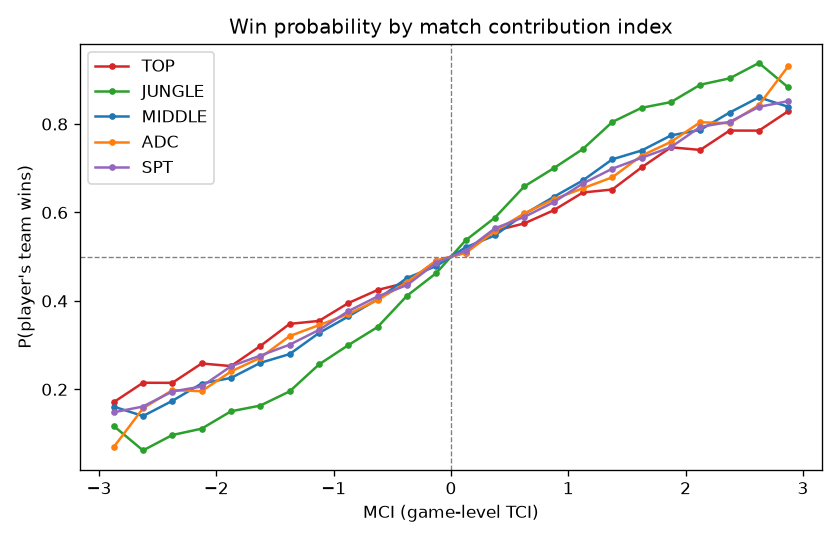

**[Fig. 10]** MCI에 따른 승리 확률

### 4.3 챌린저와 다른 상위권 플레이어의 비교

50게임 이상 플레이한 역할을 기준으로, 챌린저(299명, 347개 역할)와 그 외 플레이어(1,341개 역할)의 MCI를 비교했다.

| 구분 | 역할 수 | MCI 평균 | 승률 |
|---|---|---|---|
| 챌린저 | 347 | 0.191 | 55.4% |
| 그 외 | 1,341 | 0.007 | 50.1% |

**[Table 11]** 챌린저와 그 외 플레이어의 MCI 비교 (50게임 이상)

티어 정보를 사용하지 않은 TCI가 실력이 높은 것으로 알려진 집단을 더 높게 평가했다.
다만 챌린저 명단은 분석 기간 마지막 날(2025년 4월 8일) 기준이므로, 이 기간에 많이 승리한 소환사가 챌린저가 되었을 가능성이 있다. TCI가 승패를 직접 학습하지 않았더라도 승리와 관련된 플레이를 반영하므로, 이 비교는 완전히 독립적인 검증은 아니다.

### 4.4 챌린저 소환사 프로파일

선행 연구의 방식에 따라, 50게임 이상 플레이한 챌린저를 역할별로 MCI 평균(x축, 기여 수준)과 표준편차(y축, 기복)로 나타냈다. 점의 크기는 게임 수, 색은 해당 역할의 승률이다.
비챌린저 플레이어는 챌린저와 함께한 게임만 데이터에 포함되어 그들의 전체 경기를 대표하지 못하므로, 프로파일 분석은 기간 내 모든 게임이 수집된 챌린저로 한정했다.

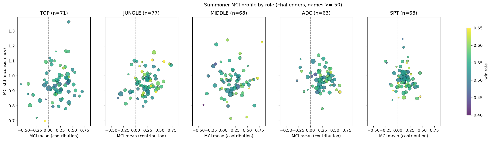

**[Fig. 11]** 역할별 챌린저 MCI 프로파일 (50게임 이상)

| 역할 | 인원 | MCI 평균 | MCI > 0 비율 | MCI 평균과 승률의 상관 |
|---|---|---|---|---|
| TOP | 71 | 0.19 | 80% | −0.05 |
| JUNGLE | 77 | 0.20 | 84% | 0.27 |
| MIDDLE | 68 | 0.20 | 78% | 0.44 |
| ADC | 63 | 0.23 | 89% | 0.34 |
| SPT | 68 | 0.13 | 84% | 0.09 |

**[Table 12]** 역할별 챌린저 MCI 요약

[Fig. 11]에서 관찰되는 주요 경향은 다음과 같다.

첫째, 챌린저의 78\~89%가 맞상대보다 평균적으로 우세했다. 챌린저가 상대하는 플레이어 역시 대부분 최상위권이라는 점을 고려하면, TCI가 최상위권 안에서도 차이를 포착한다는 의미이다.

둘째, MCI 표준편차의 평균은 0.95\~0.98로, 같은 소환사라도 게임마다 약 ±1 정도의 MCI 변동이 흔하게 발생한다. 선행 연구의 미드라이너 결과(약 0.92)와 비슷한 수준이며, 5개 역할 모두에서 재현되었다.

셋째, MCI 평균과 승률의 상관은 MIDDLE(0.44)과 ADC(0.34)에서 뚜렷했으나 TOP(−0.05)과 SPT(0.09)에서는 거의 없었다.
챌린저끼리는 실력과 승률(54\~56%)의 차이가 원래 작다. 이렇게 비교 대상의 범위가 좁으면 실제로 관계가 있더라도 상관계수가 작게 나오는데, 이를 범위 제한이라 한다. 예를 들어 키와 농구 실력은 일반인 전체에서는 관련이 크지만, 키가 모두 비슷한 프로 선수들끼리 비교하면 관련이 약하게 보이는 것과 같다.
또한 역할당 63\~77명이라 상관계수의 오차 범위(약 ±0.23)도 크다.
50게임 이상 플레이한 전체 플레이어로 범위를 넓히면 모든 역할에서 양의 상관(SPT 0.15 \~ JUNGLE 0.36)이 나타났다.
즉 TCI와 승률의 관계는 넓은 실력 범위에서는 뚜렷하지만 최상위권 내부에서는 약해진다.

넷째, 서포터는 MCI 평균의 범위가 가장 좁고 승률과의 관계도 가장 약했다. 이는 2.2절에서 확인한 것처럼 골드+XP 타겟이 시야 장악 등 서포터의 기여를 충분히 담지 못하기 때문이다.

다섯째, 정글은 MCI 평균이 높을수록 표준편차도 큰 경향(상관 0.29)이 있다. 기여가 큰 정글러일수록 게임마다 편차가 크다는 해석이 가능하지만, 이를 확정하려면 추가 분석이 필요하다.

요약하면, 라인별 TCI와 MCI는 승패나 티어를 직접 학습하지 않고 타임라인 데이터만으로 맞상대 대비 기여 수준과 기복을 정량화하며, 게임 단위에서는 승률과 강하게 정렬되고 소환사 단위에서는 챌린저를 다른 상위권 플레이어와 구분한다.
다만 분석 대상이 2025년 시즌 초 한국 서버 챌린저 게임에 한정되어 있고, 챔피언과 조합의 특성을 반영하지 못했으며, 골드+XP 타겟이 서포터의 시야 기여를 담지 못한다는 점은 이 지표를 활용할 때 고려해야 한다.
