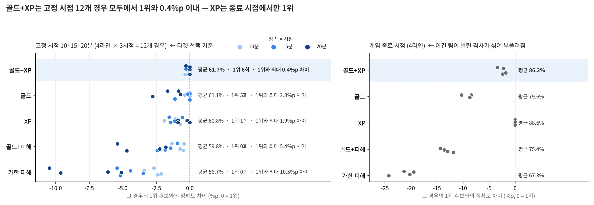
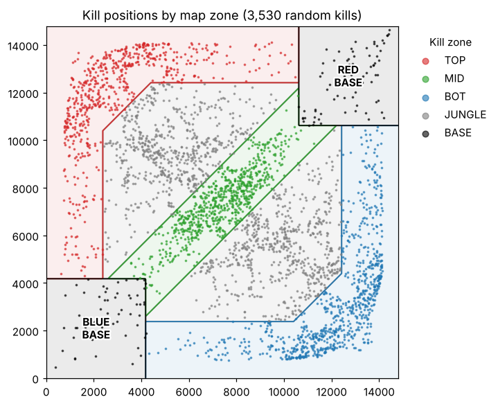
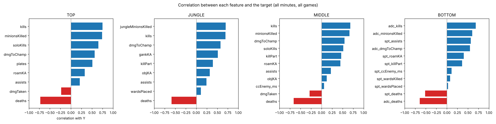
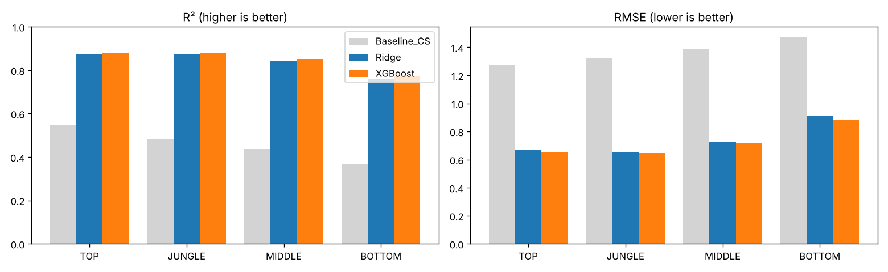
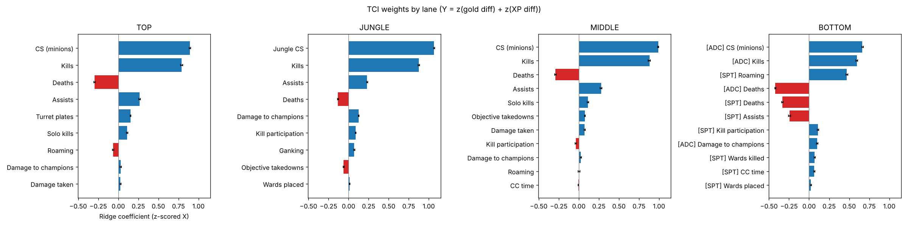
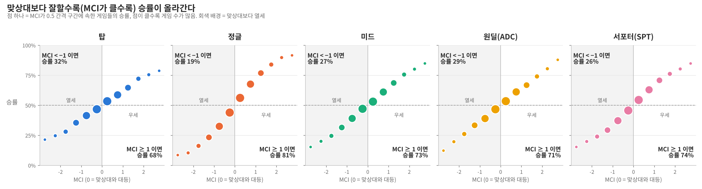
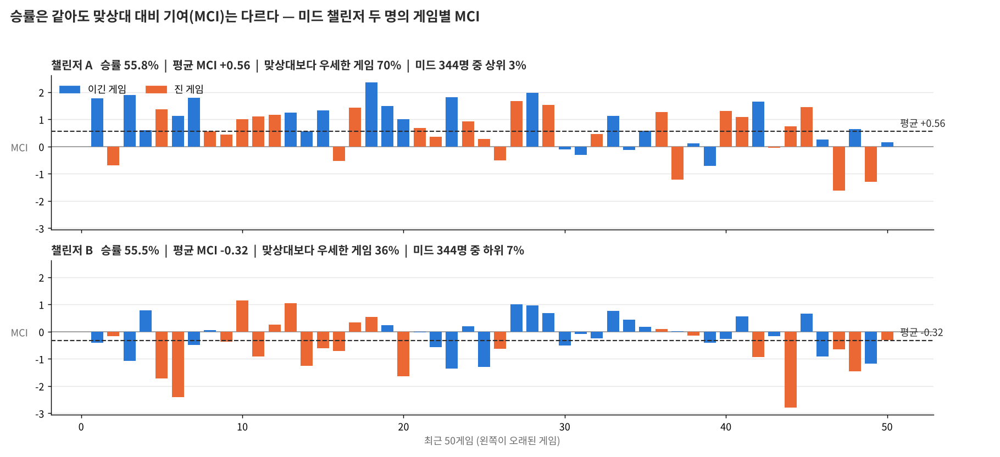
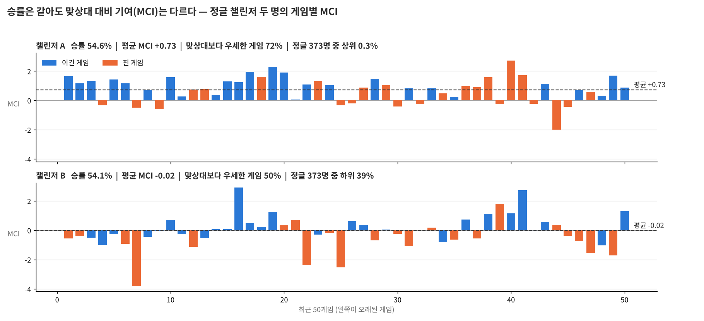

# 리그 오브 레전드 경기력 평가를 위한 라인별 타임라인 기여도 지수의 설계 및 활용

## 1. 개 요

---

리그 오브 레전드(League of Legends, 이하 LoL)는 아시안게임 정식 종목으로 채택될 만큼 그 인기와 파급력이 이미 증명된 게임이다.
LoL을 플레이하는 가장 보편적인 방식은 랭크게임으로, 5대5 솔로랭크 매치가 대표적이다.
솔로랭크 매치는 최대 2명의 소환사가 함께 플레이할 수 있으며, 플레이의 일차적인 목적은 게임을 숙달하여 랭크를 올리는 데 있다.
솔로랭크는 최고 수준의 실력을 갖는 프로게이머나 스트리머도 플레이하며, 흔히 실력을 유지하거나 새로운 전략 또는 챔피언을 시험하는 목적으로 알려져 있다.
실제로 이 연구의 데이터에서도 챌린저 중 294명의 게임 내 이름(Riot ID)을 확인한 결과, 최소 15명(약 5%)이 T1, DRX, DK, NS, KT, HLE 등 프로팀 이름을 앞에 붙인 선수 계정이었다. 팀 이름을 붙이지 않는 선수도 있으므로 실제 프로게이머 수는 이보다 많다.

솔로랭크는 무작위로 구성된 팀의 대결이므로, 특정 소환사가 잘하고도 패배하거나 그 반대의 경우가 흔하다.
따라서 솔로랭크 분석에서 단순한 승패 예측이나 팀워크 분석은 개인의 실력을 평가하려는 목적에 부합하지 않을 가능성이 높다.
반면 게임 플레이 과정에서 나타나는 우열을 지표로 나타내는 것이 더 합리적인 분석 목적이 된다.
이에 이 보고서에서는 라인별로 LoL 경기력을 과정 지표로 나타내는 타임라인 기여도 지수를 설계하고, 이를 한 게임 단위의 기여 평가에 활용한다.

이 연구의 모든 소스코드는 GitHub에 올려 두었다(데이터 파일 제외): https://github.com/dlsrb/lol-data

### 1.1 분석 데이터

LoL 개발사인 Riot Games는 자사의 개발자 웹페이지를 통해 게임 데이터를 API 방식으로 무료 제공한다[[1]](https://developer.riotgames.com/apis).
게임 데이터는 게임이 끝난 시점의 기록을 담은 매치(match) 데이터와, 1분 간격의 기록과 사건(킬, 와드 설치 등)을 담은 타임라인(timeline) 데이터로 구성된다.

이 연구의 분석 데이터는 2025년 1월 8일부터 2025년 4월 7일까지 한국 서버(KR) 챌린저 티어 소환사가 플레이한 게임 중 **20분 이상 진행된 38,075건**이다.
선행 연구[2]에 따르면 이 기간에 수집된 전체 게임은 53,279건이며, 그중 20분 이상 진행된 38,075건이 이 연구에 제공되었다.
여기서 챌린저 티어 300명은 2025년 4월 8일 기준이며, 이 중 299명의 식별자(puuid)가 확인되었다.
제공된 원본 데이터에는 처음부터 20분 이상 진행된 게임만 들어 있으며(가장 짧은 게임 20분 1초), 모든 게임에 챌린저가 1명 이상 포함되어 있다.
분석의 일관성을 위해 다음 세 조건을 추가로 적용했다.

| 정제 조건 | 제외 건수 |
|---|---|
| 솔로랭크(queueId 420)가 아닌 게임 (자유랭크 등) | 641 |
| 2024 시즌 패치(14.x) 게임 | 148 |
| 40분 초과 게임 (선행 연구와 동일 기준) | 799 |
| 제외 합계 (여러 조건에 동시에 해당하는 게임은 한 번만 계산) | 1,548 |

**[Table 1]** 정제 조건별 제외 건수

그 결과 **최종 분석 대상은 36,527건**이다.
분 단위 데이터는 의미 있는 사건이 거의 없는 4분까지와 게임이 끝나는 마지막 기록을 빼고 5\~40분 구간을 사용했다.

원본 JSON은 선행 연구에서 제공한 추출 코드(`data_process_sample.py`)의 방식을 전체 데이터로 확장하여 분석용 표로 정리했다(`extract_tci_csv.py`).
정리한 표의 마지막 시점 골드와 킬·데스·어시스트는 **매치 데이터의 종료 기록과 100% 일치**해, 추출 과정에 오류가 없음을 확인했다.

### 1.2 경기력 평가를 위한 기본 방향

선행 연구[[2]](https://www.kci.go.kr/kciportal/ci/sereArticleSearch/ciSereArtiView.kci?sereArticleSearchBean.artiId=ART003327764)는 한국 챌린저 솔로랭크 게임 13,890건으로 미드라이너의 경기력을 분 단위로 평가했다.
선행 연구는 13개의 후보 플레이 기록 중 5개(데스, 솔로데스, 받은 피해, XP, CS)를 골라, 여러 기록을 하나의 점수로 묶어 주는 통계 방법(주성분분석, PCA)으로 타임라인 기여도 지수를 만들었다. 그리고 이 점수로 두 미드라이너 중 누가 골드가 앞서는지를 얼마나 잘 맞히는지로 타당성을 확인했다.

이 연구는 선행 연구를 4개의 라인(TOP, JUNGLE, MIDDLE, BOTTOM)으로 확장하여 라인별로 <b>타임라인 기여도 지수(Timeline Contribution Index, 이하 TCI)</b>를 설계한다.
여기서 BOTTOM은 봇 듀오를 의미하며, 원거리 딜러(ADC)와 서포터(SPT)의 조합으로 설계한다.

라인별 TCI는 "정답을 보여 주고 맞히는 법을 배우게 하는" 방식(지도학습)으로 만든다. 즉 컴퓨터에 입력(라인별 플레이 기록, 예: CS·킬·데스)과 정답(경기력을 나타내는 값, 예: 골드+XP 격차)을 함께 주고, 입력만 보고 정답을 맞히는 계산식을 스스로 찾게 한다. 이렇게 찾은 계산식을 모델이라고 부른다.
모든 값은 <b>같은 시점, 같은 포지션의 맞상대와의 차이(블루팀 값 − 레드팀 값)</b>로 계산한다. 같은 게임 같은 시간대의 맞상대를 기준으로 삼으면 게임 양상과 경기 시간의 영향을 줄일 수 있기 때문이다.

또한 차이의 크기는 시간에 따라 크게 달라지므로, 분 시점마다 <b>표준 점수(z-score)</b>로 바꾸었다.
표준 점수는 시험의 "등수"처럼 <b>"같은 시점의 다른 게임들과 비교해 얼마나 앞섰는가"</b>를 나타낸다. 0이면 보통, +1이면 꽤 앞섬(100게임 중 위에서 약 16등), +2면 아주 크게 앞섬(100게임 중 위에서 약 2등)이다.
예를 들어 5분의 1,000골드 차이와 35분의 1,000골드 차이는 의미가 전혀 다르지만, 표준 점수로 바꾸면 "그 시점에서 얼마나 큰 차이인가"로 같은 기준에서 비교할 수 있다.

$$
TCI_{LANE} (\vec{x}, t ; \theta), ~~~\text{where}~~LANE \in \{ TOP,~JUNGLE,~MIDDLE,~BOTTOM\}
$$

이 식은 "라인(LANE)마다, $t$분까지의 플레이 기록($\vec{x}$)을 넣으면 그 시점의 기여 점수(TCI)가 나오는 계산식"이라는 뜻이다. $\theta$는 그 계산식 안에서 각 기록을 얼마나 중요하게 볼지 정하는 숫자들(3장의 가중치)이다.

### 1.3 분석 목적

이 연구가 답하려는 질문은 다음과 같다.

> **솔로랭크 한 게임에서 그 소환사가 같은 라인 맞상대보다 얼마나 잘했는가를, 승패와 상관없이 플레이 과정으로 잴 수 있는가?**

이를 위해 다음 순서로 진행한다.

1. **무엇을 "앞섰다"의 기준으로 볼 것인가** (2.1절): 승패 예측 정확도를 근거로 타겟을 정한다.
2. **라인마다 어떤 플레이가 우위를 만드는가** (2.2절, 3장): 라인별 피처를 정하고, 피처로 타겟을 설명하는 모델(TCI)을 만든다.
3. **한 게임의 기여를 점수로 나타낼 수 있는가** (4.1\~4.4절): TCI를 게임 단위로 요약한 매치 기여 지수(MCI)를 만들고, 실제 게임에서 어떻게 읽히는지 확인한다.
4. **한 소환사의 실력을 나타낼 수 있는가** (4.5절): 한 소환사의 여러 게임 MCI를 모아 실력 지표를 만들고, 승률이 같은 챌린저끼리(미드, 정글) 비교한다.

### 1.4 이 보고서에서 쓰는 말

통계나 머신러닝을 몰라도 읽을 수 있도록, 자주 나오는 말을 미리 풀어 둔다.

| 용어 | 쉬운 뜻 | LoL 예시 |
|---|---|---|
| 격차 (차이) | 같은 시점, 같은 포지션의 맞상대와 비교한 값 (블루팀 값 − 레드팀 값) | 15분에 블루 탑 CS 120, 레드 탑 CS 100이면 CS 격차 +20 |
| 누적 | 게임 시작부터 그 시점까지 모두 더한 값 | 15분까지 쌓인 킬 수 |
| 타겟 (정답, $y$) | 모델이 맞혀야 하는 값 | 이 연구에서는 골드+XP 격차 |
| 피처 (입력, $x$) | 정답을 맞히는 데 쓰는 플레이 기록 | CS, 킬, 데스, 포탑 방패 등 |
| 모델 | 피처를 넣으면 정답을 예측해 주는 계산식 | "CS 격차 × 0.89 + 킬 격차 × 0.79 + …" |
| 가중치 ($w$) | 계산식에서 각 피처에 곱하는 숫자. 클수록 그 피처가 중요하다 | 탑 CS의 가중치 0.89 |
| 평균 | 모든 값을 더해 개수로 나눈 값 | |
| 표준편차 | 값들이 평균에서 보통 얼마나 떨어져 있는지 (흩어진 정도) | 15분 탑 골드 격차는 보통 ±1,455골드 정도 벌어진다 |
| 표준 점수 | (값 − 평균) ÷ 표준편차. "그 시점에서 몇 칸 앞섰나"로, 0은 보통, +1은 꽤 앞섬 | 15분 골드 격차 +1,455 ≈ 표준 점수 +1 |
| 상관 | 두 값이 함께 움직이는 정도. +1에 가까우면 같이 커지고, −1에 가까우면 하나가 커질 때 다른 하나는 작아지며, 0이면 관계없음 | CS 격차와 골드 격차의 상관 0.74 (같이 커짐), 데스와는 −0.73 |
| 학습 데이터 / 평가 데이터 | 모델이 공부하는 문제집 / 공부가 끝난 뒤 처음 보는 시험 문제. 시험 문제는 공부에 쓰지 않는다 | 학습 29,222게임 / 평가 7,305게임 |
| 오차 | 실제 정답과 예측의 차이 (실제 − 예측) | 실제 +2인데 +1.5로 예측하면 오차 0.5 |
| R² (설명력) | 모델이 정답을 얼마나 잘 맞히는지 0\~1로 나타낸 점수. 1이면 완벽 (3.2절) | R² 0.875 |
| %p (퍼센트포인트) | 퍼센트끼리의 차이 | 60%에서 61%가 되면 1%p 올랐다고 한다 |
| 백분위 | 100명을 한 줄로 세웠을 때의 위치 | 상위 3% = 100명 중 위에서 3등 안 |
| TCI | 이 연구가 만든 "그 분 시점의 맞상대 대비 우위 점수" (3장) | |
| MCI | TCI를 한 게임 동안 평균 낸 "그 게임의 맞상대 대비 기여 점수" (4장) | MCI +1이면 그 게임에서 맞상대를 꽤 앞섰다 |

**[Table 2]** 용어 풀이

---

## 2. 변수 설정

---

### 2.1 타겟 변수 설정

TCI를 학습하려면 "경기력이 좋다"를 대신할 수 있는 값, 즉 모델이 맞혀야 할 정답(타겟 변수, $y$)이 필요하다.
후보로 골드, 경험치(XP), 챔피언에게 가한 피해량, 그리고 이들의 조합(골드+XP, 골드+피해량)을 검토했다.
모든 후보는 라인별 맞상대와의 차이로 계산했으며, BOTTOM은 ADC와 SPT의 값을 합산한 듀오 차이로 계산했다.

먼저 차이의 크기가 시간에 따라 어떻게 변하는지 확인했다([Table 3]).
맞상대와의 골드 차이가 보통 얼마나 벌어지는지(표준편차)를 보면, 5분에는 330\~600골드였지만 35분에는 2,700\~3,600골드로 **6\~9배 커진다.**
같은 1,000골드 차이라도 5분에는 매우 큰 우위이고 35분에는 평범한 차이라는 뜻이므로, 분 시점별 표준 점수로 바꿔 사용했다.

| 라인 | 5분 | 15분 | 25분 | 35분 |
|---|---|---|---|---|
| TOP | 345 | 1,455 | 2,368 | 3,075 |
| JUNGLE | 408 | 1,222 | 2,190 | 2,805 |
| MIDDLE | 334 | 1,230 | 2,085 | 2,691 |
| BOTTOM | 600 | 1,877 | 2,972 | 3,629 |

**[Table 3]** 시점별 맞상대와의 골드 차이의 표준편차 (골드)

후보를 고르는 기준은 <b>"그 지표에서 앞선 쪽이 실제로 게임을 이겼는가"(승패 예측 정확도)</b>로 정했다.
타겟은 승패가 아닌 과정 지표여야 하지만, 승패와 전혀 관계없는 지표라면 경기력을 대신한다고 보기 어렵기 때문이다.
이는 선행 연구에서 제공한 `evaluate_y.py`(게임 종료 시점 팀 골드 합계로 승패를 맞히는 정확도)를 라인별, 여러 시점, 여러 후보로 확장한 것이다(`evaluate_y_full.py`).
게임 종료 시점의 값에는 "이겨서 벌어진 차이"가 섞여 정확도가 부풀려지므로, 종료 시점과 함께 10분, 15분, 20분의 정확도를 비교했다.

| 시점 | 라인 | 골드 | XP | 가한 피해 | 골드+XP | 골드+피해 |
|---|---|---|---|---|---|---|
| 종료 | TOP | 0.742 | 0.845 | 0.643 | 0.811 | 0.709 |
| 종료 | JUNGLE | 0.816 | 0.902 | 0.689 | 0.878 | 0.772 |
| 종료 | MIDDLE | 0.771 | 0.855 | 0.660 | 0.832 | 0.736 |
| 종료 | BOTTOM | 0.857 | 0.944 | 0.701 | 0.925 | 0.800 |
| 10분 | TOP | 0.560 | 0.553 | 0.539 | 0.559 | 0.555 |
| 10분 | JUNGLE | 0.584 | 0.577 | 0.554 | 0.588 | 0.574 |
| 10분 | MIDDLE | 0.568 | 0.549 | 0.545 | 0.567 | 0.564 |
| 10분 | BOTTOM | 0.582 | 0.567 | 0.555 | 0.578 | 0.574 |
| 15분 | TOP | 0.589 | 0.578 | 0.555 | 0.587 | 0.580 |
| 15분 | JUNGLE | 0.612 | 0.617 | 0.571 | 0.623 | 0.598 |
| 15분 | MIDDLE | 0.602 | 0.587 | 0.558 | 0.599 | 0.588 |
| 15분 | BOTTOM | 0.619 | 0.607 | 0.567 | 0.621 | 0.603 |
| 20분 | TOP | 0.623 | 0.628 | 0.579 | 0.630 | 0.612 |
| 20분 | JUNGLE | 0.676 | 0.703 | 0.599 | 0.700 | 0.649 |
| 20분 | MIDDLE | 0.639 | 0.639 | 0.586 | 0.647 | 0.625 |
| 20분 | BOTTOM | 0.683 | 0.690 | 0.603 | 0.699 | 0.652 |

**[Table 4]** 타겟 후보별 승패 예측 정확도 (그 값이 앞선 쪽이 실제로 이긴 비율. 0.742 = 74.2%, 36,527게임)

표만 보면 XP가 더 좋아 보이지만, 그것은 게임 종료 시점의 값 때문이다. [Fig. 1]는 각 경우(라인 × 시점)마다 1위 후보와 얼마나 차이 나는지를 후보별로 모은 것이다(0 = 그 경우 1위, 왼쪽으로 갈수록 1위보다 낮음).

**[Fig. 1]** 타겟 후보별 승패 예측 정확도 비교 (각 경우의 1위 후보와의 차이)

- **게임 종료 시점에서는 XP가 1위**(평균 88.6%)이고 골드+XP는 2위(86.2%)이다. 그러나 종료 시점의 값에는 이긴 팀이 마지막 교전과 건물 파괴에서 벌린 격차가 섞여 있어 "과정"보다 "결과"에 가깝다. 그래서 타겟을 고르는 기준으로는 쓰지 않았다.
- **고정 시점(10·15·20분)의 12개 경우에서는 골드+XP가 1위 6번, 2위 6번**으로 한 번도 3위 아래로 내려가지 않았고, 1위와의 차이도 **최대 0.4%p**였다. 4개 라인 모두에서 고정 시점 평균 정확도가 가장 높았다(TOP 59.2%, JUNGLE 63.7%, MIDDLE 60.5%, BOTTOM 63.3%).
- **XP**는 고정 시점에서 1위가 1번(JUNGLE 20분)뿐이고 4위가 5번이었다. 10·15분에는 TOP·MIDDLE·BOTTOM에서 골드보다 0.7\~1.9%p 낮았다. 즉 XP는 늦은 시점과 정글에서는 좋지만 라인전 시점에는 약하다.
- **골드**는 1위가 5번이지만 JUNGLE 20분에는 1위와 2.8%p 차이가 났다. 정글러의 우위가 골드보다 XP(레벨)에 더 잘 드러나기 때문으로 볼 수 있다.
- **가한 피해**는 모든 경우에서 가장 낮았고(1위와 최대 10.5%p 차이), 골드에 더해도(골드+피해) 골드보다 낮아졌다. 그래서 피해량은 타겟이 아닌 피처로 사용했다.

따라서 골드+XP를 고른 이유는 정확도가 압도적으로 높아서가 아니라(골드 단독과의 평균 차이는 0.5%p로 작다), <b>골드가 약한 곳(정글, 늦은 시점)은 XP가, XP가 약한 곳(라인전 시점)은 골드가 보완해 어느 라인·시점에서도 1위와 0.4%p 이내를 유지하는 가장 안정적인 후보</b>이기 때문이다.

정확도가 60%대에 그치는 이유도 확인했다. 골드+XP 차이가 클수록 블루팀 승률은 꾸준히 올라가지만(예: JUNGLE에서 +2 이상 앞서면 15분 75%, 20분 87%), 차이가 0 근처(−1\~+1)인 경우가 전체의 약 40%이고 이때 승률은 55\~61%에 머문다.
즉 정확도가 낮은 것은 타겟이 나빠서가 아니라, **한 라인의 차이만으로는 팀 전체의 승패를 다 설명할 수 없다는 솔로랭크의 특성**을 반영한다.

골드와 XP는 단위가 다르므로(골드는 수천, XP는 수백 단위), 각각 분 시점별 표준 점수로 바꾼 뒤 같은 비중으로 더했다.
평균과 표준편차는 학습 데이터(문제집)로만 계산해, 평가 데이터(시험 문제)의 정보가 미리 섞이지 않도록 했다.

$$
y_{g,t} = \frac{\Delta Gold_{g,t} - \mu^{Gold}_t}{\sigma^{Gold}_t} + \frac{\Delta XP_{g,t} - \mu^{XP}_t}{\sigma^{XP}_t}
$$

여기서 $g$는 게임, $t$는 분 시점, $\Delta$는 블루팀 값 − 레드팀 값(격차)이다. $\mu_t$는 그 시점 격차의 평균, $\sigma_t$는 표준편차이다. 즉 "골드 격차의 표준 점수 + XP 격차의 표준 점수"이다.
타겟에 사용한 골드와 XP, 그리고 XP로 정해지는 레벨은 정답을 그대로 보는 것을 막기 위해 피처에서 제외했다.

### 2.2 라인별 피처 설정

피처는 선행 연구[2]의 13개 후보 피처를 출발점으로, 각 라인의 역할에 대한 도메인 지식을 더해 정했다.
선행 연구의 피처 중 XP는 타겟에 포함되므로 제외했고, 선행 연구에서 미니언과 정글 몬스터를 합산한 CS는 라인 특성을 반영하기 위해 둘로 나누었다.
여기에 로밍, 갱킹, 포탑 방패, 와드, ADC/SPT 역할 분리 등 선행 연구에 없는 피처를 라인별로 추가했다.
모든 피처는 해당 분 시점까지의 누적값을 맞상대와의 차이로 계산하고, 분 시점별 표준 점수로 바꾸었다.

#### 피처의 정의

각 피처의 정의는 다음과 같다.

| 구분 | 피처 | 정의 | 반영하는 특성 |
|---|---|---|---|
| 공통 | minionsKilled | 미니언 처치 수 (TOP, MIDDLE, ADC의 CS) | 라인 성장 |
| 공통 | jungleMinionsKilled | 정글 몬스터 처치 수 (JUNGLE의 CS) | 정글 성장 |
| 공통 | kills, deaths, assists | 챔피언 처치·사망·처치 관여 횟수 | 교전 성과와 생존 |
| 공통 | dmgToChamp | 적 챔피언에게 가한 피해량 | 교전 기여 |
| 공통 | dmgTaken | 받은 피해량 | 교전 노출 |
| 고유 | soloKills | 어시스트 없이 같은 포지션의 맞상대를 처치한 횟수 | 라인전 1:1 기량 |
| 고유 | plates | 포탑 방패 파괴 횟수 | 사이드 라인 압박 |
| 고유 | killPart | (킬 + 어시스트) / 팀 전체 킬 | 교전 관여 |
| 고유 | objKA | 엘리트 몬스터(드래곤, 전령, 바론 등) 처치 또는 어시스트 횟수 | 오브젝트 관여 |
| 고유 | wardsPlaced, wardsKilled | 와드 설치·제거 횟수 | 시야 |
| 고유 | ccEnemy_ms | 적에게 건 군중제어 시간(ms) | 아군 지원 |
| 고유 | roamKA | 자기 라인 구역 밖에서 발생한 킬에 관여한 횟수(아래 "로밍과 갱킹은 어떻게 셌나" 참조) | 로밍 |
| 고유 | gankKA | 라인 구역(탑·미드·봇)에서 발생한 킬에 관여한 횟수(아래 "로밍과 갱킹은 어떻게 셌나" 참조) | 정글 갱킹 |

**[Table 5]** 라인 공통 피처와 고유 피처의 정의

#### 로밍과 갱킹은 어떻게 셌나

로밍은 라이너가 자기 라인을 떠나 다른 라인이나 정글의 교전에 합류하는 플레이이고, 갱킹은 정글러가 라인에 개입해 적 라이너를 처치하려는 플레이이다.
둘 다 LoL에서 중요한 기여 방식이지만 공식 데이터에는 해당 지표가 없으므로 직접 정의해야 한다.

타임라인 데이터는 플레이어 위치를 1분에 한 번만 기록하므로, 위치 기록으로는 짧은 로밍을 대부분 놓친다.
반면 챔피언 처치 이벤트(`CHAMPION_KILL`)에는 발생 시각, 발생 좌표, 처치자(`killerId`), 어시스트한 플레이어(`assistingParticipantIds`)가 모두 기록된다.
따라서 이 연구는 킬 이벤트를 기준으로 다음 세 단계로 로밍과 갱킹을 계산했다.

1. **킬이 일어난 구역 분류**: 각 킬의 좌표(x, y)를 맵의 다섯 구역 중 하나로 분류한다([Table 6], [Fig. 2]).
2. **관여 기록**: 그 킬의 처치자와 어시스트한 모든 플레이어에게 "해당 구역에서 킬 관여 1회"를 더한다.
3. **로밍과 갱킹 계산**
   - 로밍(라이너) = 자기 라인 구역이 아닌 곳(다른 두 라인 구역과 정글 구역)에서의 킬 관여 횟수. 자기 라인 구역은 TOP은 TOP, MIDDLE은 MID, ADC와 SPT는 BOT이다.
   - 갱킹(정글러) = 세 라인 구역(TOP, MID, BOT)에서의 킬 관여 횟수.
   - 양 팀 본진(BASE)에서 일어난 킬은 라인전과 관계가 없으므로 둘 다에서 제외했다.

예를 들어 8분에 미드라이너가 봇 라인에서 일어난 킬을 어시스트했다면 미드라이너의 로밍이 1 늘고, 같은 킬에 정글러도 관여했다면 정글러의 갱킹도 1 늘어난다.
로밍과 갱킹은 다른 피처와 마찬가지로 **게임 시작부터 그 분 시점까지의 누적 횟수**를 맞상대와의 차이로 사용했다.
이 정의는 킬로 이어진 로밍만 포착하며, 킬 없이 끝난 로밍 시도는 반영하지 못한다는 한계가 있다.

| 구역 | 좌표 조건 (맵 좌표 약 0\~14,800, 위에서부터 차례로 적용) |
|---|---|
| BASE | x < 4,200 이고 y < 4,200 (블루 본진), 또는 x > 10,600 이고 y > 10,600 (레드 본진) |
| TOP | x < 2,400 (왼쪽 세로 띠), 또는 y > 12,400 (위쪽 가로 띠), 또는 y − x > 8,000 (왼쪽 위 모서리) |
| BOT | y < 2,400 (아래쪽 가로 띠), 또는 x > 12,400 (오른쪽 세로 띠), 또는 x − y > 8,000 (오른쪽 아래 모서리) |
| MID | \|x − y\| < 1,600 (가운데 대각선 띠) |
| JUNGLE | 나머지 (정글과 강가) |

**[Table 6]** 킬 좌표의 구역 분류 기준

구역 경계는 연구자가 정한 근사 기준이므로 전체 데이터로 검증했다.
10분 이전에 같은 라인의 맞상대끼리 발생한 킬은 대부분 해당 라인에서 일어나므로, 이 킬이 해당 라인 구역으로 분류되는 비율을 계산했다(BOTTOM은 2대2 라인이므로 ADC·SPT 간 교차 킬 포함).
그 결과 241,523건 중 84.9%가 올바르게 분류되었으며, 라인별로는 TOP 91.3%, BOTTOM 85.6%, MIDDLE 75.3%였다.
MIDDLE이 낮은 것은 미드 라인 구역을 맵 중앙의 좁은 대각선 띠로 정의해, 미드 라인과 붙어 있는 강가에서 일어난 교전이 정글 구역으로 분류되기 때문이며 이는 구역 정의의 한계이다.

**[Fig. 2]** 맵 구역 분류 (색 영역 = 구역, 점 = 실제 챔피언 처치 위치 일부)

#### 라인별로 피처를 넣은 이유

각 피처를 넣은 이유와, 전체 데이터에서 계산한 타겟과의 상관([Fig. 3])은 다음과 같다. 상관은 −1\~+1 사이의 값으로, +1에 가까울수록 "그 피처에서 앞설수록 골드+XP도 앞선다", −1에 가까울수록 "그 피처가 많을수록 골드+XP는 뒤처진다"(예: 데스), 0에 가까울수록 "별 관계없다"는 뜻이다.

**[Fig. 3]** 라인별 피처와 타겟의 상관 (36,527게임, 5\~40분)

##### TOP

| 피처 | 넣은 이유 | 타겟과의 상관 |
|---|---|---|
| CS | 탑은 정글러의 개입이 상대적으로 적어 1:1 라인전이 길게 이어지므로, 라인에서 미니언을 얼마나 챙기는지가 성장의 핵심이다. 선행 연구[2]의 성장 피처 | 0.74 |
| 킬 | 교전 성과. 선행 연구[2]의 교전 피처 | 0.75 |
| 데스 | 죽어 있는 동안 라인의 CS와 XP를 잃는 리스크. 선행 연구[2]의 리스크 피처 | −0.73 |
| 어시스트 | 라인을 벗어나 팀 교전에 관여한 정도 | 0.21 |
| 솔로킬 | 도움 없이 맞상대를 처치한 횟수로, 1:1 라인전 기량을 직접 보여 준다. 선행 연구[2]의 솔로킬 | 0.65 |
| 포탑 방패 | 라인 우위를 상대 포탑 압박으로 바꾸는 사이드 라인 운영 | 0.51 |
| 가한 피해 | 교전 기여. 탑에는 탱커와 브루저가 많아 교전에서 주고받는 피해량이 크다 | 0.56 |
| 받은 피해 | 교전에서 노출된 정도(리스크). 선행 연구[2]의 리스크 피처 | −0.23 |
| 로밍 | 사이드 라인을 떠나 다른 라인이나 정글 교전에 합류한 정도. 탑은 맵 끝에 있어 합류가 어려우므로 합류 자체가 플레이 특징이 된다 | 0.32 |

**[Table 7-1]** TOP 피처와 넣은 이유

##### JUNGLE

| 피처 | 넣은 이유 | 타겟과의 상관 |
|---|---|---|
| 정글 CS | 정글러는 미니언이 아닌 정글 몬스터로 성장한다 | 0.70 |
| 킬 | 교전 성과. 선행 연구[2]의 교전 피처 | 0.69 |
| 데스 | 리스크. 선행 연구[2]의 리스크 피처 | −0.59 |
| 어시스트 | 라인 개입과 교전에서 아군의 킬을 도운 정도 | 0.24 |
| 킬 관여율 | 팀 전체 킬 중 자신이 관여한 비율로, 맵 전체에 개입해 아군의 우위를 만드는 정글러의 역할을 나타낸다 | 0.40 |
| 오브젝트 관여 | 드래곤·전령·바론 처치를 주도하는 정글러의 고유 역할. 선행 연구[2]의 objKA | 0.32 |
| 가한 피해 | 교전 기여 | 0.58 |
| 와드 설치 | 적 정글러의 동선을 파악하기 위한 시야 활동 | 0.11 |
| 갱킹 | 라인에 개입해 아군 라이너의 우위를 만드는 정글러의 핵심 플레이 | 0.51 |

**[Table 7-2]** JUNGLE 피처와 넣은 이유

##### MIDDLE

| 피처 | 넣은 이유 | 타겟과의 상관 |
|---|---|---|
| CS | 라인전 성장. 선행 연구[2]의 미드라이너 성장 피처 | 0.66 |
| 킬 | 교전 성과. 선행 연구[2]의 교전 피처 | 0.68 |
| 데스 | 리스크. 선행 연구[2]의 리스크 피처 | −0.66 |
| 어시스트 | 다른 라인과 교전에서 아군의 킬을 도운 정도 | 0.22 |
| 솔로킬 | 선행 연구[2]가 미드라이너의 라인전 기량으로 설명한 피처 | 0.52 |
| 킬 관여율 | 선행 연구[2]가 라인을 벗어난 교전 관여로 설명한 피처 | 0.47 |
| 오브젝트 관여 | 맵 중앙에 있어 정글러와 함께 드래곤·전령 싸움에 합류하기 쉽다 | 0.13 |
| 가한 피해 | 교전 기여. 선행 연구[2]의 교전 피처 | 0.55 |
| 받은 피해 | 교전에서 노출된 정도(리스크). 선행 연구[2]의 리스크 피처 | −0.28 |
| CC 시간 | 선행 연구[2]에서 전투 스타일을 나타낸 군중제어 기여 | 0.06 |
| 로밍 | 맵 중앙에 있어 양쪽 라인을 지원하기 쉬운 역할. 이 연구에서 추가 | 0.45 |

**[Table 7-3]** MIDDLE 피처와 넣은 이유

##### BOTTOM (ADC·SPT)

| 역할 | 피처 | 넣은 이유 | 타겟과의 상관 |
|---|---|---|---|
| ADC | CS | 성장해서 지속적으로 피해를 넣는 원거리 딜러는 CS가 성장의 핵심이다 | 0.60 |
| ADC | 킬 | 교전을 마무리하는 주 딜러의 성과 | 0.69 |
| ADC | 데스 | 원거리 딜러는 살아 있어야 피해를 넣을 수 있으므로 생존이 중요하다 | −0.64 |
| ADC | 가한 피해 | 팀의 주 딜러로서의 교전 기여 | 0.55 |
| SPT | 어시스트 | 서포터는 직접 킬보다 아군의 킬을 돕는 방식으로 기여한다 | 0.57 |
| SPT | 데스 | 서포터가 죽으면 바텀이 2대1 열세가 되므로 생존이 듀오의 성장에 중요하다 | −0.51 |
| SPT | 킬 관여율 | 팀 전체 킬 중 관여한 비율로, 교전 관여를 나타낸다 | 0.36 |
| SPT | 와드 설치 | 서포터의 주요 역할인 시야 장악 | 0.03 |
| SPT | 와드 제거 | 상대 시야를 없애는 시야 장악 | 0.08 |
| SPT | CC 시간 | 아군 보호와 교전 개시 | 0.11 |
| SPT | 로밍 | CS를 먹지 않아 라인을 비워도 손실이 적으므로 다른 라인을 지원하기 쉽다 | 0.40 |

**[Table 7-4]** BOTTOM (ADC·SPT) 피처와 넣은 이유

상관은 전체 데이터에서 계산한 피처와 타겟의 상관이다([Fig. 3]).

서포터의 와드 설치(0.03), 와드 제거(0.08), CC 시간(0.11)은 타겟과의 상관이 매우 낮다.
이는 데이터 오류가 아니라 **골드+XP라는 타겟이 시야 장악 같은 서포터의 기여를 담지 못하기 때문**이며, 서포터의 역할 특성을 반영하고 그 영향이 작다는 사실 자체를 확인하기 위해 피처에 포함했다.

#### 최종 피처를 정하기 전에 확인한 것

후보 피처를 모두 그대로 쓰지 않고, 모델을 만들기 전에 다음 두 가지를 먼저 확인했다.

1. **타겟과의 상관([Fig. 3])**: 각 피처가 골드+XP 격차와 같은 방향으로 움직이는지, 관계가 얼마나 강한지 확인했다.
2. **피처끼리 정보가 겹치는지**: 두 피처가 항상 같이 움직이면(상관이 매우 높으면) 사실상 같은 정보를 두 번 넣는 셈이므로 하나만 남겨야 한다. 이 확인으로 다음 두 피처를 제외했다(`feature_screen.py`).

솔로데스(soloDeaths)는 차이로 계산하면 "블루가 맞상대를 솔로킬한 수"와 "레드가 맞상대에게 솔로데스한 수"가 같아져 **솔로킬과 완전히 같은 정보**가 된다(상관 −1).
오브젝트 관여 비율(objPart)은 타겟과의 상관이 −0.02\~0.08로 거의 없었고, TOP과 MIDDLE에서는 오브젝트 관여 횟수(objKA)와 정보가 겹쳐(상관 0.78, 0.74) 횟수 쪽만 사용했다.

#### 타겟과의 상관이 0.5보다 낮은 피처도 넣은 이유

타겟과의 상관(절대값)이 0.5보다 낮은 피처도 일부 남겼다. 이유는 두 가지이다.

첫째, **상관은 피처 하나만 볼 때의 관계일 뿐, 그 피처가 새로운 정보를 주는지는 알려 주지 않는다.** 상관이 높은 피처(CS, 킬, 데스 등)와 정보가 겹치지 않는다면, 상관이 낮아도 함께 쓸 때 설명을 보탤 수 있다. 실제로 상관이 낮은 피처들은 상관이 높은 피처들과 많이 겹치지 않았다. 제외한 오브젝트 관여 비율이 오브젝트 관여 횟수와 0.74\~0.78로 겹쳤던 것과 달리, 대부분 0.6 미만이었다.

| 라인 | 상관 0.5 미만 피처 (타겟과의 상관) | 상관 높은 피처와 가장 많이 겹치는 정도 |
|---|---|---|
| TOP | 어시스트(0.21), 받은 피해(−0.23), 로밍(0.32) | 0.52 (받은 피해 − 가한 피해) |
| JUNGLE | 어시스트(0.24), 킬 관여율(0.40), 오브젝트 관여(0.32), 와드 설치(0.11) | 0.54 (어시스트 − 갱킹) |
| MIDDLE | 어시스트(0.22), 킬 관여율(0.47), 오브젝트 관여(0.13), 받은 피해(−0.28), CC 시간(0.06), 로밍(0.45) | 0.59 (로밍 − 킬) |
| BOTTOM | SPT 킬 관여율(0.36), 와드 설치(0.03), 와드 제거(0.08), CC 시간(0.11), 로밍(0.40) | 0.71 (SPT 로밍 − SPT 어시스트) |

**[Table 8]** 상관 0.5 미만 피처와, 상관이 높은 피처와 겹치는 정도 (전체 데이터의 피처 간 상관 절대값)

둘째, **라인의 역할을 반영하기 위해서이다.** 서포터의 와드·CC처럼 골드+XP와 관련이 약해도 그 라인의 핵심 역할인 피처는, 영향이 작다는 사실 자체가 결과가 된다.

다만 BOTTOM의 SPT 로밍과 SPT 어시스트는 0.71로 다른 피처들보다 많이 겹쳐, 모델에서 두 피처의 가중치가 나뉘는 문제가 생겼다(3.2절). 상관이 낮은 피처를 넣은 것이 실제로 도움이 되었는지는 모델을 만든 뒤 3.3절에서 확인했다.

#### 최종 라인별 피처

위의 확인을 거친 최종 라인별 피처는 다음과 같다.

| 라인 | 피처 (개수) |
|---|---|
| TOP (9) | CS, 킬, 데스, 어시스트, 솔로킬, 포탑 방패, 가한 피해, 받은 피해, 로밍 |
| JUNGLE (9) | 정글 CS, 킬, 데스, 어시스트, 킬 관여율, 오브젝트 관여, 가한 피해, 와드 설치, 갱킹 |
| MIDDLE (11) | CS, 킬, 데스, 어시스트, 솔로킬, 킬 관여율, 오브젝트 관여, 가한 피해, 받은 피해, CC 시간, 로밍 |
| BOTTOM (11) | ADC: CS, 킬, 데스, 가한 피해 / SPT: 어시스트, 데스, 킬 관여율, 와드 설치, 와드 제거, CC 시간, 로밍 |

**[Table 9]** 라인별 최종 피처

---

## 3. 경기력 지표 모델링

---

### 3.1 모델 선정

입력은 분 시점 $t$까지의 라인별 피처 차이이고, 출력은 같은 시점의 골드+XP 차이이다.
피처는 골드와 XP를 직접 포함하지 않지만, <b>골드와 XP를 얻는 과정(CS, 킬, 생존 등)</b>을 담고 있으므로 피처로 타겟이라는 숫자를 맞히는 문제(회귀)로 풀 수 있다.
학습된 모델의 예측값 $\hat{y}$("와이 햇", 예측한 $y$라는 뜻)가 곧 해당 시점의 TCI이며, <b>"골드와 XP를 보지 않고 플레이 과정만으로 추정한 맞상대 대비 우위"</b>로 해석한다.

같은 게임의 10분과 11분 기록은 거의 비슷하므로, 한 게임의 일부는 문제집에, 일부는 시험에 들어가면 시험이 쉬워진다. 그래서 데이터는 **게임 단위**로 나누었다.
36,527게임을 학습 80%(29,222게임)와 평가 20%(7,305게임)로 나누었고, 두 집합에 겹치는 게임은 없다.
모델의 설정값은 학습 데이터 안에서만 골랐고, 평가 데이터는 최종 성능 측정에만 한 번 사용했다.

모델은 성격이 다른 두 종류를 하나씩 골라 비교했다.

| 모델 | 작동 방식 | 장점 | 단점 |
|---|---|---|---|
| 릿지 회귀 (Ridge) | 각 피처에 가중치를 곱해 더한 값으로 예측 (예: CS × 0.89 + 킬 × 0.79 + …) | **가중치가 곧 각 플레이의 기여도**여서 해석이 쉽다 | "킬은 CS가 많을 때만 효과가 크다" 같은 복잡한 관계는 표현하지 못한다 |
| XGBoost | "킬 차이가 2 이상인가?" 같은 예/아니오 질문을 이어 가며 답을 정하는 규칙표(결정 나무)를 수백 개 만들어 합쳐 예측 | 복잡한 관계까지 학습할 수 있다 | 왜 그렇게 예측했는지 사람이 이해하기 어렵다 |
| 기준선 (CS만 사용) | CS 차이 하나만 쓴 직선식 | 비교 기준 | 플레이 과정 정보가 없다 |

**[Table 10]** 비교한 모델

**릿지 회귀**는 각 피처에 가중치를 곱해 모두 더한 값으로 타겟을 예측한다.

$$
\hat{y}_i = w_1 x_{i1} + w_2 x_{i2} + \cdots + w_p x_{ip}
$$

예를 들어 TOP이라면 "예측 = 0.89 × (CS 격차) + 0.79 × (킬 격차) − 0.29 × (데스 격차) + …"이다.
그렇다면 0.89, 0.79 같은 가중치는 어떻게 정할까? 릿지 회귀는 다음 값이 가장 작아지는 가중치를 찾는다.

$$
\sum_i (y_i - \hat{y}_i)^2 + \alpha \sum_j w_j^2
$$

| 기호 | 뜻 | 이 연구에서 |
|---|---|---|
| $i$ | 몇 번째 기록인지 | (게임, 분) 하나가 기록 하나. TOP 학습 데이터에는 680,075개가 있다 |
| $x_{ij}$ | $i$번째 기록의 $j$번째 피처 값 | 예: 그 시점 CS 격차의 표준 점수 |
| $p$ | 피처 개수 | TOP 9, JUNGLE 9, MIDDLE 11, BOTTOM 11 |
| $w_j$ | $j$번째 피처의 가중치 | 그 피처의 표준 점수가 1 오를 때 예측이 얼마나 오르는가. [Table 14]의 숫자 (예: TOP CS 0.89) |
| $y_i$ | 실제 정답 | 그 시점의 골드+XP 격차 (2.1절) |
| $\hat{y}_i$ | 모델의 예측값 | 이것이 TCI이다 |
| $\sum$ | 모두 더하기 | $\sum_i$는 모든 기록에 대해, $\sum_j$는 모든 피처에 대해 더한다는 뜻 |
| $\alpha$ | 벌점의 세기 | 클수록 가중치를 0 쪽으로 강하게 줄인다. 0이면 벌점이 없는 일반 선형회귀와 같다 |

**[Table 11]** 릿지 회귀 식의 기호

식을 말로 풀면 다음과 같다.

- **앞부분 $\sum_i (y_i - \hat{y}_i)^2$ = "틀린 정도의 합"**: 기록마다 (실제 − 예측)을 구하고, 그 값을 제곱(자기 자신을 한 번 더 곱함)해서 모두 더한다. 예를 들어 기록이 두 개이고 실제가 3과 0, 예측이 2와 2라면 틀린 정도는 1과 −2이고, 제곱하면 1과 4, 더하면 5이다. 이것을 **오차 제곱합**이라고 부른다. 작을수록 예측이 잘 맞는다는 뜻이다.
  - 제곱하는 이유: 그냥 더하면 +2와 −2가 만나 0이 되어 "하나도 안 틀렸다"고 잘못 계산된다. 제곱하면 모두 양수가 되고, 크게 틀린 것(−2 → 4)이 작게 틀린 것(1 → 1)보다 훨씬 크게 반영된다.
- **뒷부분 $\alpha \sum_j w_j^2$ = "가중치 크기에 대한 벌점"**: 가중치들을 제곱해 더한 값에 $\alpha$를 곱한다. 가중치를 너무 크게 잡으면 벌점이 커진다.
  - 벌점을 주는 이유: 킬과 가한 피해처럼 비슷한 정보를 가진 피처가 함께 있으면, 한쪽 가중치는 아주 크고 다른 쪽은 이상하게 음수가 되는 식으로 불안정해질 수 있다. 벌점이 이런 극단적인 값을 막는다.

즉 릿지 회귀는 **"예측은 잘 맞히되, 가중치는 지나치게 크지 않게"** 하는 가중치를 찾는 방법이다.

$\alpha$는 0.001부터 1,000까지 13개 값을 학습 데이터 안에서 시험해 틀린 정도가 가장 작은 값을 골랐다(TOP·MIDDLE 31.6, JUNGLE 10, BOTTOM 100).
학습 데이터가 68만 개로 매우 많아 이 정도 벌점은 가중치를 거의 바꾸지 않았고, 실제로 벌점이 없는 일반 선형회귀($\alpha = 0$)와 성능이 같았다.

**XGBoost**는 결정 나무를 하나씩 차례로 추가하는 모델이다. 첫 번째 나무가 예측하고 남은 오차를 두 번째 나무가 다시 예측하고, 그래도 남은 오차를 세 번째 나무가 예측하는 식으로 앞선 나무들이 틀린 부분을 조금씩 고쳐 나간다. 시험을 본 뒤 틀린 문제만 골라 다시 공부하는 과정을 반복하는 것과 비슷하다.
나무 개수는 나무를 하나씩 늘리면서 학습 데이터 일부로 틀린 정도를 확인하고, 더 이상 줄지 않으면 멈추는 방식으로 정했다(TOP 633개, JUNGLE 614개, MIDDLE 572개, BOTTOM 1,010개).

**기준선**은 CS 차이 하나만 쓴 모델이다. CS는 골드와 XP의 가장 큰 원천이므로, 두 모델이 기준선보다 높인 성능이 **CS 이외의 플레이 과정에서 나온 몫**이다.
이 밖에 다른 다섯 가지 모델(일반 선형회귀, 라쏘 회귀, 결정 나무, 랜덤 포레스트, LightGBM)도 같은 조건으로 학습했으며, Ridge·XGBoost와 성능 차이가 거의 없거나 더 낮았다.

### 3.2 모델링 결과

성능은 평가 데이터(7,305게임)에서 다음 지표로 확인했다.

**R²(설명력)** 는 모델이 정답을 얼마나 잘 맞히는지를 0\~1 사이 점수로 나타낸 것이다.
기준은 "아무 정보 없이 찍기"이다. 모든 기록의 정답을 평균값 하나로 똑같이 찍었을 때 틀린 정도와, 모델이 예측했을 때 틀린 정도를 비교한다.

$$
R^2 = 1 - \frac{\sum_i (y_i - \hat{y}_i)^2}{\sum_i (y_i - \bar{y})^2}
$$

말로 쓰면 **R² = 1 − (모델의 틀린 정도의 합) ÷ (평균으로 찍었을 때 틀린 정도의 합)** 이다. 분자(위)가 모델의 틀린 정도, 분모(아래)가 평균으로 찍었을 때의 틀린 정도이며, "틀린 정도의 합"은 3.1절의 오차 제곱합이고, $\bar{y}$("와이 바")는 정답의 평균이다.

- 예를 들어 평균으로 찍었을 때 틀린 정도의 합이 100이고, 모델은 12.5만큼만 틀렸다면 R² = 1 − 12.5 ÷ 100 = **0.875**이다. "찍을 때보다 틀린 정도를 87.5% 줄였다"는 뜻이고, 흔히 "정답의 변화 중 87.5%를 설명한다"고 말한다.
- R² = 1이면 하나도 안 틀린 완벽한 예측, 0이면 평균으로 찍은 것과 같은 수준이다.
- 다만 이 연구의 피처 중 CS·킬·어시스트는 골드와 XP를 직접 주는 원천이라, R²가 높게 나오는 것이 어느 정도 당연하다. 그래서 **CS 하나만 쓴 기준선의 R²와 비교해 얼마나 높아졌는지**를 함께 본다.

**RMSE** 는 "예측이 평균적으로 얼마나 틀리는가"를 정답과 같은 단위(표준 점수)로 나타낸 값이다. 오차 제곱합을 기록 수로 나눈 값(MSE, 괄호 안 숫자)에 다시 제곱근을 씌워, 제곱하기 전의 크기로 되돌린 것이다. 작을수록 좋다. 예를 들어 RMSE 0.67은 "보통 표준 점수로 0.67 정도 틀린다"는 뜻이다.

| 라인 | 기준선 R² | Ridge R² | XGBoost R² | Ridge RMSE (MSE) | XGBoost RMSE (MSE) |
|---|---|---|---|---|---|
| TOP | 0.545 | **0.875** | 0.881 | 0.668 (0.447) | 0.654 (0.428) |
| JUNGLE | 0.484 | **0.875** | 0.878 | 0.652 (0.425) | 0.645 (0.416) |
| MIDDLE | 0.436 | **0.845** | 0.849 | 0.728 (0.530) | 0.717 (0.515) |
| BOTTOM | 0.369 | **0.759** | 0.772 | 0.909 (0.827) | 0.885 (0.784) |

**[Table 12]** 모델별 평가 성능

**[Fig. 4]** 라인별 R²와 RMSE 비교

결과는 다음과 같다.

- 두 모델 모두 **CS만 쓴 기준선보다 R²가 0.33\~0.41 높았다.** 피처가 CS 이상의 플레이 과정 정보를 담고 있다는 뜻이다.
- TOP·JUNGLE·MIDDLE은 R²가 0.85\~0.88로, <b>평균으로 찍을 때보다 틀린 정도를 85\~88% 줄였다</b>. RMSE 0.65\~0.73은 정답이 보통 흩어진 정도(표준편차 약 1.85\~1.89)의 약 1/3 수준이다.
- BOTTOM은 설명력이 가장 낮았는데(0.759), 서포터의 피처가 골드+XP와 관련이 약하기 때문이다.
- XGBoost가 모든 라인에서 조금 더 정확했지만 **그 차이는 R² 0.3\~1.3%p**에 그쳤다. 즉 "가중치를 곱해 더하는" 단순한 계산식으로도 대부분 설명된다.

따라서 해석하기 쉬운 쪽을 택해 **Ridge를 최종 TCI 모델로 선정**했다.
Ridge는 가중치가 곧 각 플레이의 기여도이므로 TCI를 식으로 제시할 수 있고, BOTTOM의 TCI를 ADC 부분과 SPT 부분으로 나눌 수 있다(4.1절).

선행 연구와 비교하기 위해, TCI가 "블루가 앞선다"고 했을 때 실제로 골드도 블루가 앞선 비율(방향 일치율)을 계산했다. 선행 연구와 같이 골드 차이가 100 미만인 사실상 동점인 경우는 제외했다.

| 라인 | 기준선 | Ridge | XGBoost |
|---|---|---|---|
| TOP | 78.7% | **92.8%** | 92.7% |
| JUNGLE | 67.5% | **88.0%** | 87.9% |
| MIDDLE | 71.6% | **90.2%** | 90.0% |
| BOTTOM | 71.8% | **87.4%** | 87.2% |

**[Table 13]** TCI와 실제 골드 차이의 방향이 일치한 비율 (|골드 차이| ≥ 100)

참고로 선행 연구의 미드라이너 TCI는 같은 조건에서 80.78%였고, 이 연구의 MIDDLE TCI는 90.2%였다.
다만 선행 연구는 골드를 전혀 보지 않고 만든 지수이고 이 연구는 골드+XP를 정답으로 학습했으므로, 두 수치를 직접적인 우열로 해석해서는 안 된다.

최종 TCI의 가중치(Ridge 계수)는 다음과 같다. 막대 끝의 짧은 검은 선은 학습 게임을 무작위로 바꿔 100번 다시 학습했을 때 가중치가 움직인 범위인데, 매우 짧아서 가중치가 안정적이라는 것을 보여 준다.

**[Fig. 5]** 라인별 TCI 가중치 ([ADC]·[SPT]는 BOTTOM 안에서의 역할)

라인별 TCI는 다음 표의 가중치를 각 피처의 표준 점수에 곱해 모두 더한 값이다.

$$
TCI = w_1 x_1 + w_2 x_2 + \cdots + w_p x_p
$$

| 피처 | TOP | JUNGLE | MIDDLE | BOTTOM (ADC) | BOTTOM (SPT) |
|---|---|---|---|---|---|
| CS (미니언) | **+0.89** | · | **+0.99** | **+0.66** | · |
| 정글 CS | · | **+1.07** | · | · | · |
| 킬 | **+0.79** | **+0.88** | **+0.88** | **+0.59** | · |
| 데스 | −0.29 | −0.13 | −0.29 | −0.42 | **−0.33** |
| 어시스트 | +0.27 | +0.23 | +0.28 | · | −0.24 |
| 솔로킬 | +0.11 | · | +0.11 | · | · |
| 포탑 방패 | +0.15 | · | · | · | · |
| 가한 피해 | +0.03 | +0.13 | +0.03 | +0.10 | · |
| 받은 피해 | +0.03 | · | +0.07 | · | · |
| 킬 관여율 | · | +0.09 | −0.04 | · | +0.11 |
| 오브젝트 관여 | · | −0.06 | +0.08 | · | · |
| 와드 설치 | · | +0.01 | · | · | +0.02 |
| 와드 제거 | · | · | · | · | +0.07 |
| CC 시간 | · | · | −0.004 | · | +0.07 |
| 로밍 | −0.06 | · | +0.005 | · | **+0.47** |
| 갱킹 | · | +0.07 | · | · | · |

**[Table 14]** 라인별 TCI 가중치 (굵은 글씨 = 그 라인에서 가장 큰 두 가중치, · = 그 라인에서 쓰지 않은 피처)

예를 들어 어느 시점에 탑이 맞상대보다 CS가 표준 점수로 +1, 킬이 +1 앞서고 나머지 피처가 모두 같다면, TCI는 0.89 + 0.79 = +1.68이다. 반대로 데스가 +1 많다면 0.29만큼 깎인다.
BOTTOM은 ADC 열과 SPT 열을 모두 더한 값이 듀오의 TCI이며, 4장에서는 두 열을 나누어 ADC와 SPT 각자의 점수로 쓴다.

모든 라인에서 **CS와 킬이 가장 큰 두 축**이고, 어시스트가 그다음이며, 데스는 감점 요인이다. 이들은 골드와 XP를 직접 주는 원천이므로 예상된 결과이다.
라인 간 차이는 다음과 같다.

| 라인 | 눈에 띄는 가중치 | 해석 |
|---|---|---|
| JUNGLE | 정글 CS **1.07**, 데스 **−0.13** | 정글 CS 가중치가 모든 라인 CS 중 가장 크고, 데스 감점은 탑·미드(−0.29)의 절반 이하이다. 정글러는 죽어도 라인의 CS와 XP를 직접 놓치지 않기 때문으로 볼 수 있다 |
| TOP | 포탑 방패 **0.15** | 고유 피처가 의미 있게 나타나 사이드 라인 압박을 반영한다 |
| BOTTOM | SPT 데스 **−0.33**, ADC 데스 −0.42 | 서포터의 데스가 ADC에 가까운 큰 감점이다. 서포터의 생존이 듀오의 성장에 중요하다 |
| TOP · MIDDLE · SPT | 로밍 **−0.06 · 0.00 · +0.47** | 같은 로밍이라도 탑은 작은 감점, 미드는 거의 영향이 없고, 서포터는 BOTTOM에서 세 번째로 큰 가점이다. 라인을 비우면 CS와 XP를 놓치는 라이너와 달리, CS를 먹지 않는 서포터는 그런 손실이 없다 |

마지막 줄처럼 **같은 피처가 라인에 따라 다르게 작용**한다는 점은 TCI를 라인별로 설계해야 하는 근거가 된다.

가중치를 읽을 때는 주의가 필요하다. 가중치는 <b>"다른 피처가 모두 같을 때 그 피처 하나만 1 늘어나면"</b>의 효과이므로, 피처 하나만 따로 본 상관과 방향이 반대로 나타날 수 있다.
예를 들어 서포터의 어시스트는 단독으로는 타겟과 상관이 높지만(0.57) 가중치는 음수(−0.24)이다. 서포터의 어시스트와 로밍은 둘 다 아군의 킬에 관여한 횟수라 정보가 많이 겹치기 때문에, 그 몫이 로밍 쪽에 크게 실리고 어시스트는 음수로 나뉜 것이다.
따라서 이는 "어시스트가 손해"라는 뜻이 아니며, **서포터의 어시스트와 로밍은 따로 떼지 않고 "킬 관여"로 함께 읽어야 한다.**
또한 모든 가중치는 "함께 나타나는 경향"을 보여 줄 뿐, "이것 때문에 저것이 생긴다"는 원인과 결과를 뜻하지는 않는다.

### 3.3 피처 구성 확인

2.2절에서 타겟과의 상관이 0.5보다 낮은 피처도 남겼는데, 그 선택이 맞았는지 모델로 확인했다. 즉 "상관이 높은(절대값 0.5 이상) 피처만 쓰면 결과가 더 좋지 않은가?"를 실험했다(`feature_threshold.py`).
학습 데이터로 계산한 상관이 0.5 이상인 피처만 남겨 같은 릿지 회귀로 다시 학습하고, 평가 데이터에서 비교했다.

| 라인 | 전체 피처 R² | 상관 0.5 이상만 R² | 차이 | 빠진 피처 |
|---|---|---|---|---|
| TOP | 0.875 (9개) | 0.866 (6개) | −1.0%p | 어시스트, 받은 피해, 로밍 |
| JUNGLE | 0.875 (9개) | 0.864 (5개) | −1.2%p | 어시스트, 킬 관여율, 오브젝트 관여, 와드 설치 |
| MIDDLE | 0.845 (11개) | 0.827 (5개) | −1.8%p | 어시스트, 킬 관여율, 오브젝트 관여, 받은 피해, CC 시간, 로밍 |
| BOTTOM | 0.759 (11개) | 0.725 (6개) | −3.4%p | SPT 킬 관여율·와드 설치·와드 제거·CC 시간·로밍 |

**[Table 15]** 상관 0.5 기준으로 피처를 거른 경우의 성능 비교 (평가 데이터)

- **모든 라인에서 0.5 기준으로 거르면 설명력이 떨어졌다(1.0\~3.4%p).** 어시스트처럼 혼자서는 타겟과의 관계가 약해도(상관 0.21\~0.24) 킬·CS가 알려 주지 않는 새로운 정보를 가진 피처가 있기 때문이다. 모델에서는 "다른 피처가 이미 알려 준 것 말고, 새로 더해 주는 정보"가 중요하다.
- 반대로 가중치가 0.05 미만인 피처(TOP의 가한·받은 피해, JUNGLE의 와드 설치, MIDDLE의 킬 관여율·가한 피해·로밍·CC 시간, SPT의 와드 설치)만 빼면 R² 변화가 0.03%p 이하로 거의 없었다. 이 피처들은 성능에는 기여하지 않지만, 라인의 역할을 반영했을 때 그 영향이 작다는 것 자체를 보여 주기 위해 남겼다.

---

## 4. TCI의 활용: 한 게임의 기여 평가

---

1.3절의 질문은 "한 게임에서 그 소환사가 같은 라인 맞상대보다 얼마나 잘했는가를 승패와 상관없이 잴 수 있는가"였다.
이 장에서는 분 단위 TCI를 게임 단위로 요약한 점수를 만들고, (1) 실제 게임에서 어떻게 읽히는지, (2) 승패와 따로 움직이는지, (3) 그래도 의미 있는 점수인지를 차례로 확인한다.

### 4.1 매치 기여 지수(MCI)의 정의

선행 연구[2]는 분 단위 TCI를 게임 단위로 평균한 <b>매치 기여 지수(Match Contribution Index, MCI)</b>를 정의했다. 이 연구는 이를 4개 라인, 5개 역할로 확장한다.

1. 한 게임에서 분 단위 TCI의 평균을 구한다.
2. 블루팀 플레이어에게는 그대로, 레드팀 플레이어에게는 +와 −를 바꾸어 준다(TCI는 블루 − 레드 기준이므로, 블루가 +2면 레드는 −2).
3. 역할마다 점수 크기가 다르므로, 그 역할의 전체 게임 점수가 보통 흩어진 정도(표준편차)로 나누어 같은 기준으로 맞춘다. 즉 MCI도 표준 점수처럼 읽는다.

따라서 **MCI = 0은 맞상대와 대등, MCI = +1은 맞상대보다 뚜렷하게 우세(상위 약 16% 수준), MCI = −1은 뚜렷하게 열세**를 뜻한다.
한 게임에서 맞상대 두 명의 MCI는 부호만 반대이다.

BOTTOM의 TCI는 "가중치 × 피처"를 더한 식이므로, ADC 피처 부분의 합과 SPT 피처 부분의 합으로 나눌 수 있다. ADC에게는 ADC 항의 합을, SPT에게는 SPT 항의 합을 각자의 점수로 부여해, 듀오로 학습한 모델에서 개인별 MCI를 얻었다.

학습이 끝난 TCI는 고정된 식이므로, 이 장에서는 전체 36,527게임에 적용했다. 모델의 성능 확인은 3.2절에서 평가 데이터로만 수행했다.
또한 **TCI는 학습 과정에서 승패 정보를 전혀 사용하지 않았다**(승패는 2.1절에서 타겟 후보를 비교하는 데에만 사용했다).

### 4.2 예시: 한 게임 읽기

MCI가 한 게임에서 어떻게 읽히는지 실제 게임(`KR_7575893150`, 패치 15.6, 28분 31초, 블루팀 승리)으로 확인했다.

| 역할 | 블루팀 (승리) MCI | 레드팀 (패배) MCI |
|---|---|---|
| TOP | −3.47 | **+3.47** |
| JUNGLE | +1.34 | −1.34 |
| MIDDLE | +1.07 | −1.07 |
| ADC | +1.89 | −1.89 |
| SPT | +0.32 | −0.32 |

**[Table 16]** 예시 게임의 역할별 MCI

이 게임에서 레드팀 탑은 16킬 3데스 3어시스트, 미니언 처치 202개(블루팀 탑 146개), 솔로킬 9회(매치 기록 기준)로 맞상대를 크게 앞섰고, **MCI +3.47**을 받았다.
그러나 나머지 네 역할이 모두 맞상대에게 밀려(MCI −0.32\~−1.89) 레드팀은 패배했다.
승패만 보면 레드팀 탑은 "진 플레이어"이지만, MCI는 <b>"맞상대를 압도했지만 팀이 진 게임"</b>으로 구분해 준다.

### 4.3 MCI는 승패와 따로 움직이는가

예시와 같은 경우가 얼마나 흔한지 전체 게임에서 확인했다.

- **진 플레이어의 37.5%는 MCI가 0보다 컸다.** 즉 진 게임의 3분의 1 이상에서 맞상대보다는 잘했다.
- 진 플레이어의 **8.3%는 MCI 1 이상**으로, 맞상대를 뚜렷하게 앞서고도 졌다. 역할별로는 탑 10.1%, ADC 9.1%, 미드 8.4%, SPT 8.0%, 정글 6.0%였다.
- 게임 단위로 보면 **35.2%의 게임에서 진 팀에 MCI 1 이상인 플레이어가 한 명 이상** 있었다.
- 반대로 이긴 플레이어의 37.5%는 MCI가 0보다 작았다(맞상대에게 밀렸지만 팀이 이김).

따라서 MCI는 승패를 그대로 따라가지 않고, **팀 결과와 별개로 개인이 맞상대 대비 얼마나 잘했는지**를 보여 준다. 이는 1장에서 말한 "잘하고도 패배하거나 그 반대의 경우가 흔하다"는 솔로랭크의 특성과 맞는다.

### 4.4 MCI는 의미 있는 점수인가

반대로 MCI가 승패와 전혀 관계없다면, 경기력을 나타낸다고 보기 어렵다. 그래서 MCI 구간별 승률을 확인했다.

| 역할 | MCI < −1 | −1 ≤ MCI < 0 | 0 ≤ MCI < 1 | MCI ≥ 1 |
|---|---|---|---|---|
| TOP | 31.7% | 44.3% | 55.7% | **68.3%** |
| JUNGLE | 19.3% | 38.9% | 61.1% | **80.7%** |
| MIDDLE | 27.5% | 43.6% | 56.4% | **72.5%** |
| ADC | 28.9% | 43.2% | 56.8% | **71.1%** |
| SPT | 26.0% | 41.9% | 58.1% | **74.0%** |

**[Table 17]** MCI 구간별 승률 (36,527게임)

승패를 학습하지 않았는데도 <b>모든 역할에서 MCI가 높을수록 승률이 단계적으로 올라갔고</b>, 맞상대보다 뚜렷하게 우세한(MCI ≥ 1) 게임의 승률은 <b>68.3\~80.7%</b>였다.
표의 왼쪽과 오른쪽이 합쳐서 100%가 되는 것은, 맞상대 두 명의 MCI가 +와 −만 반대이고 한 명이 이기면 다른 한 명은 지기 때문이다. 그래서 실제로 봐야 할 정보는 MCI ≥ 0인 오른쪽 두 열에 있다.

[Table 17]을 MCI 0.5 간격으로 나누어, 각 구간에 속한 게임들의 승률을 점 하나로 나타냈다([Fig. 6], 점이 클수록 게임 수가 많고, 회색 배경은 맞상대보다 열세인 구간).
모든 역할에서 MCI가 커질수록 승률이 거의 직선으로 올라가며, **기울기는 정글이 가장 가파르고 탑이 가장 완만**하다.
정글러의 우위는 맵 전체에 영향을 주어 팀 승리로 가장 직접 이어지고, 탑은 사이드 라인이라 개인의 우위가 팀 승리로 이어지기까지의 거리가 멀다는 해석이 가능하다. 이는 4.3절에서 "잘하고도 진" 비율이 탑에서 가장 높고 정글에서 가장 낮았던 것과도 맞는다.

**[Fig. 6]** 역할별 MCI 구간별 승률

### 4.5 한 라인에서 소환사의 실력 지표 만들기

MCI는 한 게임의 점수이므로, 한 소환사의 여러 게임을 모으면 그 사람의 실력 지표가 된다. 미드와 정글에서 각각 **승률이 거의 같은 챌린저 두 명**의 실제 경기에 MCI를 적용해 비교했다(`summoner_mci.py`).
두 사람은 그 라인을 100게임 이상 플레이한 챌린저 중 승률 차이가 1%p 이내이면서 평균 MCI 차이가 가장 큰 두 명이며, 익명으로 표기했다. 정글은 4.4절에서 MCI와 승률의 연결이 가장 강했던 역할이라 함께 확인했다.

| 지표 | 미드 A | 미드 B | 정글 A | 정글 B |
|---|---|---|---|---|
| 그 라인 게임 수 | 154 | 220 | 238 | 283 |
| 승률 | 55.8% | 55.5% | 54.6% | 54.1% |
| **평균 MCI** (맞상대 대비 기여 수준) | **+0.56** | **−0.32** | **+0.73** | **−0.02** |
| 맞상대보다 우세했던 게임 비율 (MCI > 0) | 70.1% | 36.4% | 72.3% | 49.5% |
| 진 게임 중 우세했던 비율 | 61.8% | 24.5% | 50.0% | 23.8% |
| 이긴 게임 중 열세였던 비율 | 23.3% | 54.1% | 9.2% | 28.8% |
| MCI 표준편차 (기복: 게임마다 점수가 얼마나 들쭉날쭉한가) | 0.96 | 0.89 | 1.07 | 1.10 |
| 같은 라인 50게임 이상 소환사 중 위치 (평균 MCI 기준, 백분위) | 상위 3% (344명 중) | 하위 7% | 상위 0.3% (373명 중) | 하위 39% |

**[Table 18]** 승률이 같은 챌린저 두 명씩의 실력 지표 (미드, 정글)

**[Fig. 7]** 미드 챌린저 두 명의 최근 50게임 MCI (막대 위 = 맞상대보다 우세, 색 = 승패, 점선 = 전체 게임 평균 MCI)

**[Fig. 8]** 정글 챌린저 두 명의 최근 50게임 MCI

- **미드**: 승률은 55.8%와 55.5%로 같지만 평균 MCI는 +0.56(상위 3%)과 −0.32(하위 7%)로 정반대이다. A는 10게임 중 7게임에서 맞상대를 앞섰고, B는 이긴 게임의 절반 이상(54%)에서 맞상대에게 밀렸다. 자기 라인에서는 졌어도 팀이 이긴 게임이 많았다고 볼 수 있다.
- **정글**: 승률은 54.6%와 54.1%로 같지만 평균 MCI는 +0.73(상위 0.3%)과 −0.02(중간보다 조금 아래)이다. A는 이긴 게임에서 맞상대에게 밀린 경우가 9%뿐이었고, B는 29%였다.
- 따라서 **승률이 같아도 "자기 라인에서 맞상대를 이기는 실력"은 두 라인 모두 A가 B보다 높다**고 판단할 수 있다. 이것이 승률만으로는 볼 수 없는 MCI의 정보이다.

정글이 소환사 간 격차가 가장 클 것이라는 예상도 확인했다. 같은 라인을 50게임 이상 플레이한 모든 소환사의 평균 MCI를 역할별로 비교하면 다음과 같다.

| 역할 | 소환사 수 | 평균 MCI의 범위 (가장 낮음 ~ 가장 높음) | 소환사끼리 평균 MCI가 흩어진 정도 (표준편차) | 평균 MCI와 승률의 상관 |
|---|---|---|---|---|
| TOP | 326 | −0.89 ~ +0.69 | 0.26 | 0.29 |
| JUNGLE | 373 | **−1.03 ~ +0.83** | **0.27** | **0.36** |
| MIDDLE | 344 | −0.70 ~ +0.79 | 0.26 | 0.30 |
| ADC | 330 | −0.65 ~ +0.61 | 0.22 | 0.33 |
| SPT | 315 | −0.42 ~ +0.59 | 0.18 | 0.19 |

**[Table 19]** 역할별 소환사 간 평균 MCI 격차 (50게임 이상)

- 정글은 **소환사 간 범위가 가장 넓고(−1.03 ~ +0.83), 평균 MCI와 승률의 상관도 가장 높아(0.36)** 예상과 맞았다. 다만 표준편차는 0.27로 탑·미드(0.26)와 거의 같아, "정글만 격차가 유독 크다"고까지 말하기는 어렵다.
- 승률이 같은 두 명의 차이는 오히려 미드(0.88)가 정글(0.75)보다 컸다. 정글은 MCI와 승률의 연결이 가장 강해서, 승률이 같으면 MCI도 비슷해지기 쉽기 때문으로 볼 수 있다.
- 서포터는 범위와 표준편차가 가장 작다. 골드+XP 타겟이 서포터의 기여를 덜 담기 때문에 소환사 간 차이도 작게 나타난 것으로, 서포터의 실력 지표로는 한계가 있다.
- 다만 MCI는 골드+XP 우위를 기준으로 하므로, 성장보다 팀 교전 보조에 집중하는 챔피언을 주로 한 소환사의 기여는 덜 반영될 수 있다. 실력 지표로 쓸 때는 챔피언 구성도 함께 봐야 한다.
- 50게임 이상 소환사에는 챌린저가 아닌 플레이어도 포함되는데, 이들은 챌린저와 함께한 게임만 데이터에 있어 전체 경기를 대표하지 못한다.

---

## 5. 결론 및 한계

---

이 연구는 솔로랭크 한 게임에서 소환사가 같은 라인 맞상대보다 얼마나 잘했는지를 승패와 상관없이 플레이 과정으로 재는 지표(TCI, MCI)를 만들었다.
결론은 다음 세 가지이다.

### 결론 1. "맞상대보다 앞섰다"의 기준은 골드+XP 격차가 가장 적절하다

- 경기력을 대신할 타겟 변수($y$)로 골드, XP, 가한 피해와 그 조합을 비교한 결과, **골드+XP 격차가 가장 안정적인 기준**이었다([Table 4], [Fig. 1]). 고정 시점(10·15·20분) 12개 경우에서 1위 6번, 2위 6번으로 1위와의 차이가 최대 0.4%p였고, 4개 라인 모두에서 평균 정확도가 가장 높았다.
- XP는 게임 종료 시점에서 1위였지만, 그 값은 이긴 팀이 마지막에 벌린 격차가 섞인 결과에 가깝고, 라인전 시점(10·15분)에는 골드보다 0.7\~1.9%p 낮았다. 골드와 XP가 서로 약한 곳을 보완하기 때문에 둘을 더한 값을 택했다.
- 가한 피해는 모든 시점에서 가장 낮아, 피해를 많이 넣는 것만으로는 "앞섰다"고 보기 어렵다는 것을 보여 주었다. 그래서 피해량은 타겟이 아닌 피처로 사용했다.
- 골드+XP 격차가 클수록 승리 확률은 꾸준히 올라가지만(예: 정글이 20분에 +2 이상 앞서면 승률 87%), 격차가 0 근처인 게임이 약 40%라 한 라인의 격차만으로 승패를 다 설명할 수는 없다. 즉 **골드+XP 격차는 승패를 대신하는 값이 아니라, 승패와 관련 있는 개인의 과정 지표**이다.
- 라인별 TCI는 이 골드+XP 격차를 골드와 XP를 보지 않고 플레이 기록만으로 **76\~88% 설명**했다([Table 12]).

### 결론 2. 소환사의 실력은 승패가 아니라 MCI(맞상대 대비 기여)로 판단할 수 있다

- MCI는 승패를 학습하지 않았지만, <b>MCI ≥ 1인 게임의 승률은 68.3\~80.7%, MCI < −1인 게임은 19.3\~31.7%</b>로 승패와 뚜렷하게 연결된다([Table 17]). 즉 MCI는 실제 경기력을 반영한다.
- 동시에 **진 플레이어의 37.5%는 MCI가 0보다 컸고, 8.3%는 MCI 1 이상**이었다(4.3절). 승패만 보면 모두 "진 플레이어"지만, MCI는 이 중 맞상대를 이긴 소환사를 따로 구분해 준다(예: 4.2절의 레드팀 탑, 패배했지만 MCI +3.47).
- 여러 게임을 모으면 소환사의 실력 지표가 된다. 승률이 같은 챌린저끼리도 평균 MCI는 크게 달랐다. 미드는 +0.56(상위 3%) 대 −0.32(하위 7%), 정글은 +0.73(상위 0.3%) 대 −0.02였다(4.5절).
- 따라서 소환사의 실력은 팀의 승패가 아니라 <b>"같은 라인 맞상대보다 MCI가 얼마나 높은가"</b>로 객관적으로 판단할 수 있다.

### 결론 3. 라인마다 실력이 드러나는 플레이가 다르다

TCI 가중치(3.2절)와, 게임 종료 시점에 그 플레이에서 맞상대보다 앞섰는지에 따른 승률·평균 MCI를 함께 보면, 라인별로 실력을 보여 주는 플레이는 다음과 같다.

| 라인 | 실력을 보여 주는 플레이 | TCI 가중치 | 데이터 (게임 종료 시점, 맞상대와의 차이) |
|---|---|---|---|
| TOP | ① CS ② **포탑 방패** | CS 0.89, 포탑 방패 0.15 (탑 고유 피처 중 가장 큼) | 포탑 방패를 3개 이상 더 깬 탑: 평균 MCI **+1.01**, 승률 65.4% (3개 이상 덜 깬 탑 34.6%) |
| JUNGLE | ① **정글 CS** ② 적은 데스 | 정글 CS 1.07 (모든 라인의 CS 중 가장 큼), 데스 −0.13 (탑·미드의 절반 이하) | 정글 CS가 21개 이상 많은 정글러: 평균 MCI **+0.85**, 승률 79.9% (21개 이상 적으면 20.1%) |
| MIDDLE | ① CS ② 킬 | CS 0.99, 킬 0.88, 로밍 0.00 | CS가 21개 이상 많은 미드: 평균 MCI **+0.71**, 승률 55.2% (21개 이상 적으면 44.8%) |
| ADC | ① CS ② **생존(적은 데스)** | CS 0.66, 데스 −0.42 (모든 역할 중 가장 큰 데스 감점) | 맞상대보다 3번 이상 덜 죽은 원딜: 평균 MCI **+0.86**, 승률 87.6% (3번 이상 더 죽으면 12.4%) |
| SPT | ① **로밍(봇 라인 밖 킬 관여)** ② 생존 | 로밍 +0.47 (서포터 피처 중 가장 큼), 데스 −0.33 | 로밍이 3회 이상 많은 서포터: 평균 MCI **+0.65**, 승률 89.3% (3회 이상 적으면 10.7%) |

**[Table 20]** 라인별로 실력을 보여 주는 플레이

표의 데이터 열은 `conclusion_check.py`로 계산했으며, 구간별 전체 결과는 다음과 같다(`results/conclusion_check.csv`).

| 역할·플레이 | 기준 | 크게 열세 | 열세 | 같음 | 우세 | 크게 우세 |
|---|---|---|---|---|---|---|
| TOP 포탑 방패 | 3개 | 34.6% (-1.01) | 43.6% (-0.45) | 50.0% (0.00) | 56.4% (+0.45) | 65.4% (+1.01) |
| JUNGLE 정글 CS | 21개 | 20.1% (-0.85) | 40.3% (-0.20) | 50.0% (0.00) | 59.7% (+0.20) | 79.9% (+0.85) |
| JUNGLE 갱킹 | 3회 | 17.0% (-0.63) | 37.2% (-0.18) | 50.0% (0.00) | 62.8% (+0.18) | 83.0% (+0.63) |
| MIDDLE CS | 21개 | 44.8% (-0.71) | 48.7% (-0.18) | 50.0% (0.00) | 51.3% (+0.18) | 55.2% (+0.71) |
| ADC 데스 (적게 죽을수록 우세) | 3번 | 12.4% (-0.86) | 31.6% (-0.28) | 50.0% (0.00) | 68.4% (+0.28) | 87.6% (+0.86) |
| SPT 로밍 | 3회 | 10.7% (-0.65) | 35.3% (-0.11) | 50.0% (0.00) | 64.7% (+0.11) | 89.3% (+0.65) |

**[Table 21]** 핵심 플레이에서 맞상대와의 차이에 따른 승률 (괄호는 평균 MCI)

"크게 우세"는 기준만큼 이상 앞선 경우(예: 포탑 방패를 3개 이상 더 깸), "우세"는 그보다 적게 앞선 경우이다. 데스는 맞상대보다 적게 죽은 쪽을 우세로 놓았다. 갱킹은 결론에서 제외했지만 비교를 위해 함께 실었다.

이 표를 읽을 때 객관적으로 짚어야 할 점은 다음과 같다.

- 평균 MCI 열은 해당 플레이가 MCI 계산에 이미 들어 있으므로 어느 정도는 당연히 높게 나온다. 반면 **승률은 모델과 무관한 값**이므로, 두 열을 함께 봐야 한다.
- **탑의 포탑 방패는 팀 결과의 영향을 가장 적게 받는 개인 지표**이다. 데이터에서 14분 이후에는 포탑 방패 파괴가 한 건도 없어 라인전 단계에서만 얻을 수 있고, 그래서 승률 차이(34.6% → 65.4%)는 다른 라인보다 작지만 MCI 차이(−1.01 → +1.01)는 크다. 즉 팀이 이기든 지든 탑 라인에서 맞상대를 얼마나 압박했는지를 보여 준다.
- **미드의 CS**도 비슷하다. CS가 크게 앞서도 승률은 55.2%에 그쳐, 라인 우위가 곧바로 승리로 이어지지는 않는다. MCI가 승패와 별개로 개인의 라인 우위를 잡아낸다는 점을 보여 준다.
- **서포터의 로밍은 실력과 팀 상황이 함께 반영된 값**이다. 로밍은 게임 끝까지 누적하므로, 이기고 있는 팀일수록 한타에서 킬 관여가 많아지는 효과가 섞인다(로밍 3회 이상 많은 서포터의 승률 89.3%). 또한 서포터의 어시스트(−0.24)와 정보가 겹치므로, 로밍 하나만 떼어 "로밍을 많이 할수록 실력이 좋다"고 단정해서는 안 된다.
- **정글의 갱킹은 실력 지표로 꼽지 않았다.** 갱킹은 단독으로는 승률과 관계가 크지만(3회 이상 많으면 승률 83.0%), 킬·어시스트를 함께 넣은 모델에서는 가중치가 0.07로 정글 피처 중 작은 편이다. 갱킹의 효과는 대부분 킬·어시스트에 이미 담겨 있고, 서포터 로밍과 마찬가지로 이기는 팀일수록 많아지는 효과도 섞여 있다. 그래서 정글러의 실력은 가중치가 가장 큰 정글 CS로 판단하는 것이 더 객관적이다.

요약하면, 이 보고서로 소환사의 실력을 판단하는 방법은 <b>"MCI로 맞상대 대비 기여를 보고, 그 MCI가 어떤 플레이에서 나왔는지는 라인별 핵심 플레이(탑: CS·포탑 방패, 정글: 정글 CS·생존, 미드: CS·킬, 원딜: CS·생존, 서포터: 로밍·생존)로 확인하는 것"</b>이다.

### 한계

- 분석 대상이 2025년 시즌 초 한국 서버 챌린저 게임에 한정되어 있다.
- 챔피언과 조합의 특성(예: 원래 CS를 덜 먹는 챔피언)을 반영하지 못했다.
- 골드+XP 타겟이 서포터의 시야 기여를 담지 못해, 서포터의 MCI는 실제 기여를 덜 반영할 수 있다.
- 로밍과 갱킹은 킬로 이어진 경우만 포착하며, 게임 끝까지 누적하므로 후반의 한타(팀 전체 교전) 참여와 팀 상황도 함께 반영된다.
- 가중치와 표의 관계는 함께 나타나는 관계일 뿐, 원인과 결과를 뜻하지는 않는다.

---

## 참고문헌

[1] Riot Games, Riot Developer Portal - APIs, https://developer.riotgames.com/apis

[2] 추형석, "리그 오브 레전드 미드라이너 실력 평가를 위한 타임라인 기반 기여도 지수 설계와 분석 연구", 한국게임학회 논문지, 제26권 제2호, pp. 137-148, 2026. https://www.kci.go.kr/kciportal/ci/sereArticleSearch/ciSereArtiView.kci?sereArticleSearchBean.artiId=ART003327764
